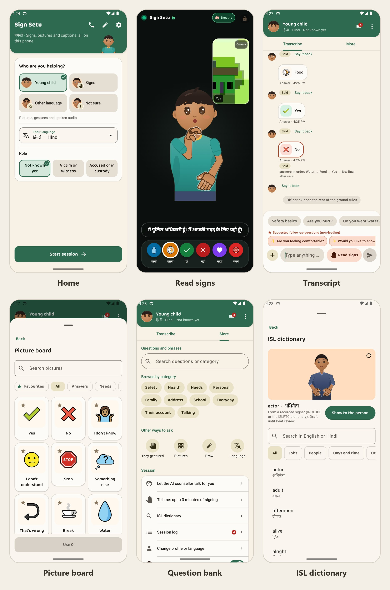

# Sign Setu

An offline Android app that helps a police officer communicate with a person who cannot communicate in words: deaf, non-verbal, traumatised or speaking another language. A code-drawn character signs and gestures, pictures and captions carry the question, typed text is played in draft Indian Sign Language order, and signed answers are read on the phone inside explicit sign windows. The app is a communication aid, not an interpreter, and never records statements.

- Version 0.7.0 (version code 10). Android 10 (API 29) and later; Kotlin and Jetpack Compose; one `app` module.
- Works fully offline. A build with a department gateway (`-PgatewayUrl=https://...`), or a private build with a direct assistant key, can use it while online once the officer switches the online assistant on; otherwise nothing ever connects. No RECORD_AUDIO permission, and no location or scanning permission in the `standard` flavor; every build fails if a forbidden permission reaches the merged manifest.
- Optional on-device assistant: Can load an instruction-tuned small language model (Gemma 3 1B Q4_K_M GGUF, ~806 MB, downloaded directly from [Hugging Face](https://huggingface.co/ggml-org/gemma-3-1b-it-GGUF/resolve/main/gemma-3-1b-it-Q4_K_M.gguf)) via in-app file import under Settings, verified against its SHA-256 hash before loading into memory.
- Includes a standalone Type-to-Sign practice screen directly on the home screen so officers can test arbitrary Hindi or English sentences outside a formal interview session.
- Automatic quiet-settle sign capture: answers ingest naturally when the signer's hands come to rest, without requiring a physical screen tap.
- Sessions live in an encrypted SQLCipher database under a Keystore key that works only while the phone is unlocked. A finished session is saved under a name the officer types and deleted after 24 hours by default; an officer or department can pick 4 to 72 hours or keep sessions until deleted.

---

## Screenshots

---

## What it does

- **Stage for the person:** a drawn character signs questions in draft ISL order (recorded ISL signers for most words), with pictures, captions in 17 languages and recorded speech; answers by tap, picture, writing, drawing, nod or shake, finger count, or signing to the camera, confirmed by the person from pictures.
- **Sign reading:** MediaPipe Holistic landmarks feed small on-device readers for ISL and ASL words and fingerspelling. Guesses that answer the question on screen, through its own answer cards (`sign_words.json`, `cards`), are ranked first; the person then confirms the meaning from pictures. Accuracy is in [tools/ml/EVAL.md](tools/ml/EVAL.md).
- **Officer side:** quick two-way transcription, a question bank including a full ISL lesson sheet (introduction, family, address, school, everyday phrases) in Hindi and English, phrases, show-back, an ISL dictionary and Manual or Auto conversation. Back leaves a session for the start screen without ending it; with a second screen connected it asks first, because leaving drops the link.
- **Second screen:** a paired phone shows the stage over bonded Bluetooth. With the online assistant on, an AI counsellor can talk with a frightened victim there while the officer watches and can send, replace or take over each line; it is never offered for an accused person or anyone in custody (`ui/session/Counsellor.kt`).
- **Records:** finished sessions are listed on the start screen, can be opened again, and export to a password-protected PDF with a hash chain and a draft BSA s.63 certificate.

## Build and test

The build needs JDK 21, Android SDK 37, NDK `30.0.16248370` and CMake 4.1.1. Dependencies are pinned in `gradle/libs.versions.toml`, locked in `app/gradle.lockfile` and verified by `gradle/verification-metadata.xml`.

| Command | Result |
| --- | --- |
| `./gradlew assembleStandardDebug` | Debug APK |
| `./gradlew testStandardDebugUnitTest` | Unit tests (also `testNearbyDebugUnitTest`) |
| `./gradlew connectedStandardDebugAndroidTest` | Instrumented tests on an emulator or phone |
| `cd portal && npm install && npx vp test` | Reviewer portal tests, including rig parity with `Rig.kt` |
| `cd backend && pip install -e ".[test]" && pytest` | Department gateway tests |
| `python tools/content/build_content.py --manifest-only` | Rebuilds the content hash manifest; run after any content change |

Tests worth knowing:

- `LessonTest` and `LessonSigningAuditTest` pin the lesson sheet's wording and how each sentence is signed.
- `SignPipelineDeviceTest` runs real ISLRTC clips (`app/src/androidTest/assets/islrtc/`) through the camera pipeline. It must pass after any MediaPipe or protobuf update: MediaPipe 1.1.1 runs on `protobuf-javalite`, and the full runtime breaks the landmarker without failing a unit test.
- `RigFixtureTest` keeps the portal's TypeScript rig in step with `Rig.kt` (see [portal/README.md](portal/README.md)).

## MVP — Live links

| Resource | URL | Notes |
| --- | --- | --- |
| 📱 Phone APK — gateway (arm64, ~83 MB) | [sign-setu-0.7.0-arm64-v8a-gateway.apk](https://github.com/Yash-Awasthi/sign-setu/releases/download/v0.7.0/sign-setu-0.7.0-arm64-v8a-gateway.apk) | Signed; calls the department gateway |
| 📱 Phone APK — no gateway (arm64, ~83 MB) | [sign-setu-0.7.0-arm64-v8a-nogateway.apk](https://github.com/Yash-Awasthi/sign-setu/releases/download/v0.7.0/sign-setu-0.7.0-arm64-v8a-nogateway.apk) | Signed; no key built in; enter an OpenAI compatible key (groq for test phase) in Settings |
| 📦 Universal APK — gateway (arm64 + x86\_64, ~109 MB) | [sign-setu-0.7.0-universal-gateway.apk](https://github.com/Yash-Awasthi/sign-setu/releases/download/v0.7.0/sign-setu-0.7.0-universal-gateway.apk) | Signed; phones, tablets and emulators; calls the department gateway |
| 📦 Universal APK — no gateway (arm64 + x86\_64, ~109 MB) | [sign-setu-0.7.0-universal-nogateway.apk](https://github.com/Yash-Awasthi/sign-setu/releases/download/v0.7.0/sign-setu-0.7.0-universal-nogateway.apk) | Signed; no key built in; enter an OpenAI compatible key (groq for test phase) in Settings |
| 🏷️ GitHub release | [v0.7.0](https://github.com/Yash-Awasthi/sign-setu/releases/tag/v0.7.0) | All APKs |
| 🌐 Department gateway (API) | [signsetu-gateway.onrender.com](https://signsetu-gateway.onrender.com) | FastAPI on Render free tier; backed by Neon Postgres; cold-start ~30 s |
| 🖥️ Reviewer portal | [signsetu-portal.pages.dev](https://fc39beea.signsetu-portal.pages.dev) | Vite + React; static on Cloudflare Pages |
| 🤖 On-device model | [gemma-3-1b-it-Q4\_K\_M.gguf on Hugging Face](https://huggingface.co/ggml-org/gemma-3-1b-it-GGUF/resolve/main/gemma-3-1b-it-Q4_K_M.gguf) | ~806 MB; import via Settings → On-device assistant |
| 📖 Full documentation | [docs/README.md](docs/README.md) | Requirements, architecture, security, DPIA |

---

## Release

| Command | Output |
| --- | --- |
| `./gradlew assembleStandardRelease` | Universal APK, arm64-v8a and x86_64 (about 109 MB): phones, tablets and emulators |
| `./gradlew assembleStandardRelease -Pabi=arm64-v8a` | Phone-only APK (about 83 MB) |

Release builds use R8 with resource shrinking. Add `-PgatewayUrl=https://...` (or `gatewayUrl=` in `local.properties`) for a gateway build. A release build fails if an assistant key (`OPENROUTER_API_KEY` or `openrouterKey`) is set, because the key would be readable from the APK; pass `-PallowEmbeddedKey` only for a private build. The APKs are signed with the release key, which is held offline; signing is a manual `zipalign` and `apksigner` step on that machine. See [docs/README.md](docs/README.md), section 8.

## Repository

| Path | Contents |
| --- | --- |
| `app/` | The Android app (`app.signsetu`; application ID `in.signsetu`), flavors `standard` and `nearby` (Play services) |
| `app/src/main/assets/content/` | Content bundle: questions, cards, motions, vocabulary, audio, models, hash manifest |
| `backend/` | Department gateway (FastAPI, SQLAlchemy): device enrolment, model manifest, assistant proxy, consented feedback labels; optional ([README](backend/README.md)) |
| `portal/` | Static reviewer portal for content sign-off (Vite+, React, TypeScript); not shipped ([README](portal/README.md)) |
| `tools/content/` | Content bundle, audio and sign builders; `build_content.py --manifest-only` |
| `tools/isl/` | Retargeting recorded ISL and ASL signers onto the character ([README](tools/isl/README.md)) |
| `tools/ml/` | Sign reader training, export and evaluation ([README](tools/ml/README.md)) |
| `tools/security/` | CycloneDX SBOM of the release APK (`sbom.py`, needs Syft) |
| `content/` | Source symbols for the picture cards |
| `render.yaml` | Free hosting blueprint for the gateway |
| `docs/` | Requirements, architecture, security and data protection assessment ([index](docs/README.md)) |
