# 02. Architecture

How Sign Setu is built: the parts, how they talk, where data lives and which keys protect it. Every statement here is checked against the code; class and file names are given so each one can be found. Diagrams are Mermaid source.

## 1. System context

Sign Setu is one Android application. The officer's phone holds everything a session needs: the content bundle, the vision and sign-reader models, and the encrypted session store. Two optional paths leave the phone:

- **Second screen.** A bonded Bluetooth phone or tablet shows the subject's stage over an encrypted link and stores nothing (§9).
- **Online assistant.** When the build has a department gateway (`-PgatewayUrl=https://...`), or else a direct service key, and the officer has switched it on, masked text goes over HTTPS for translation, the AI counsellor and the draft report (§10). Without either, nothing in the app opens a connection.

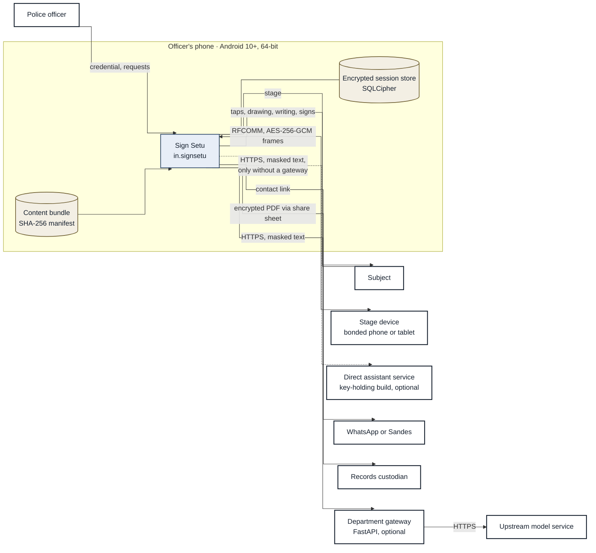

*Figure 1. System context and every path out of the phone.*

The reviewer portal (`portal/`) and the gateway (`backend/`) are separate programs in the same repository; neither ships in the APK (§13).

## 2. Principles

1. **Offline first.** Every feature works with no network. Online calls fall back to the on-device path on any failure and tell the officer once per change (`CloudAi.Notice`).
2. **Content is data.** Questions, cards, signs, translations and motions are asset files checked against a hash manifest, not code.
3. **Write before show.** Every event is written to the encrypted store before the screen reflects it.
4. **The subject owns meaning.** A machine or officer reading is a proposal; only the subject's own pick records a meaning.
5. **Small and boring.** One Gradle module, platform libraries first, manual wiring instead of a DI framework.

## 3. Technology

Versions are pinned in `gradle/libs.versions.toml`, locked in `app/gradle.lockfile` and verified by `gradle/verification-metadata.xml`.

| Layer | Choice |
| --- | --- |
| Language, UI | Kotlin 2.4.21, Jetpack Compose (BOM 2026.09.00), Material 3, Navigation 3 1.2.0 |
| SDK levels | minSdk 29, compileSdk and targetSdk 37; AGP 9.4.1; Gradle 9.8.2; JDK 21 |
| Session store | Room 2.8.5 over SQLCipher for Android 4.19.1 (database version 5) |
| Settings, work | DataStore Preferences 1.2.1; WorkManager 2.12.0 |
| Camera, vision | CameraX 1.6.2 (Preview and ImageAnalysis only); MediaPipe Tasks Vision 1.1.1, Holistic landmarker; protobuf-javalite 4.36.2 |
| Sign readers | Plain Kotlin forward passes (`LandmarkSignReader`, `CtcSpellReader`); float32 weights in the APK |
| Speech | Media3 ExoPlayer 1.11.1 for recorded Opus; platform TextToSpeech for the express board |
| Export | Android `PdfDocument` to draw, PdfBox-Android 2.0.27.0 to encrypt; BouncyCastle forced to 1.86 |
| Assistant | llama.cpp (vendored in `app/src/main/cpp/third_party`) built by CMake 4.1.1 and NDK 30 into `libassistant.so`; `HttpURLConnection` for the online path |
| Second screen | Bluetooth RFCOMM (`standard` flavor); Google Nearby Connections 19.5.1 (`nearby` flavor only) |
| Authentication | Platform `BiometricPrompt` and `KeyguardManager`; Android Keystore |
| Serialization | kotlinx.serialization JSON 1.12.0; coroutines 1.11.0 |

Not used: dependency injection frameworks, Firebase, analytics or crash SDKs, WebView, microphone APIs, camera capture or recording.

## 4. Runtime structure

### 4.1 Wiring

`SignSetuApp` builds one `AppContainer` (`SignSetuApp.kt`) at process start and registers it as a process lifecycle observer and a memory callback. Every long-lived object hangs off it.

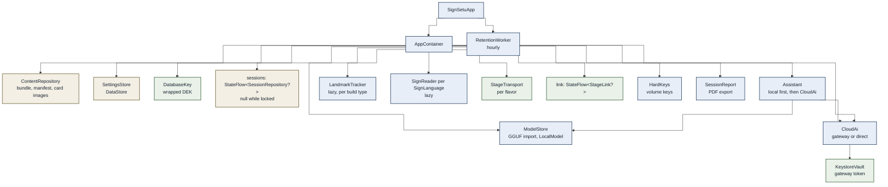

*Figure 2. What `AppContainer` owns.*

`MainActivity` sets `FLAG_SECURE` in release builds, filters touches that pass through another app's overlay, applies the officer's interface language (`OfficerLocale`) and routes the volume keys to `HardKeys` unless TalkBack is on.

### 4.2 Screen routing

`AppRoot` picks one screen from the container's state; a stage device never reaches the lock screen or the navigation, so it never opens the session store.

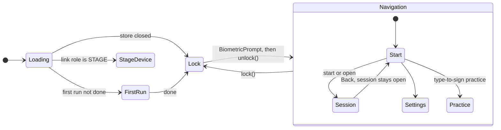

*Figure 3. `AppRoot` routing. Navigation uses Navigation 3 with one view-model store per back-stack entry.*

### 4.3 The session screen

`SessionRoute` shows either the officer page (`OfficerPane`) or the stage (`Stage`), from one `SessionViewModel`. With a second screen live, this phone stays on the officer page and the stage runs on the other device.

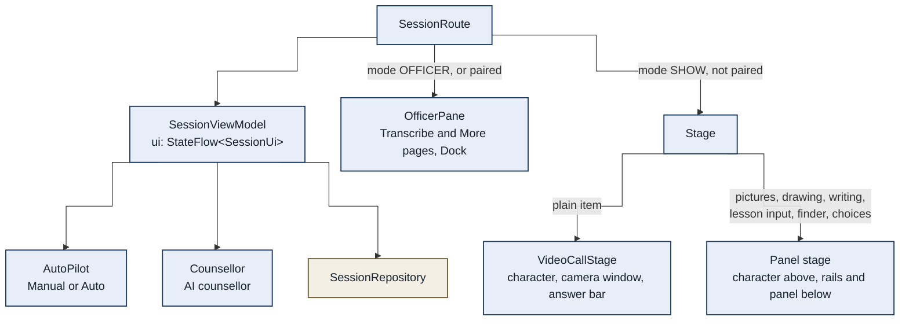

*Figure 4. The two faces of one session screen.*

While the phone's own stage shows, `SessionRoute` hides the system bars, starts screen pinning (`startLockTask`), frees the assistant model, and turns the volume keys and the tilt sensor into handover controls (`HandoverEffects`). The officer takes the phone back by the lock handle or by holding both volume keys for 1.5 s.

## 5. Packages

One module, `app.signsetu`, organised by feature.

| Package | Responsibility |
| --- | --- |
| (root) | `MainActivity`, `SignSetuApp` and `AppContainer` (wiring, unlock and relock, link ownership), `Policy` (build expiry, locked-time wipe rule) |
| `data.content` | `Content.kt` loads and verifies the bundle; `IslLexicon.kt` sign lookup, dictionary and sign languages; `TextSigning.kt` plans typed text and turns read glosses back into text; `Translate.kt` the rule-based English to Hindi caption; `Lesson.kt` answer types and validation; `Completion.kt` word completions; `Motion.kt` the keyframe types every motion file uses |
| `data.session` | Room entities and DAO, `SessionRepository` (sealed event log), `EventSeal` (hash chain), `DatabaseKey`, `RetentionWorker` |
| `data.settings` | `SettingsStore` (DataStore) and `OfficerLocale` |
| `camera` | `CameraMirror` (Preview plus ImageAnalysis), `LandmarkTracker` and `LandmarkFrame`, `HolisticTracker`, the per-frame cue detectors, `Stabilizer` |
| `sign` | `SignCapture` and `SignWindow` (segmentation), readers (`LandmarkSignReader`, `CtcSpellReader`, `SignReaders`), `ReadPolicy` and `SignChoices` (ranking and choices), `HomeSigns`, `SkeletonPlayer` |
| `pair` | The second-screen protocol with no Android UI: `PairCrypto`, `StageWire` messages, `StageTransport` and `BluetoothTransport`, `StageLink` state machine, `Drawings` |
| `assistant` | `Assistant`, `LocalModel` and `ModelStore` (llama.cpp), `CloudAi`, `Pseudonymizer`, `OfflineReport` |
| `net` | `UrlHttp` (HTTPS only) and `KeystoreVault` |
| `export` | `SessionReport` (PDF and encryption), `EvidenceIntegrity` (chain check and certificate) |
| `ui` | `AppRoot`, `LockScreen`, the session route |
| `ui.session` | Officer page, stage, view model, auto mode, counsellor, record text and grades |
| `ui.pair` | Pairing sheet, paired bar, stage-device screens, `StageBridge` and the wire mapping of what is on stage |
| `ui.avatar` | The 2D character: `Rig.kt` solver and timeline, `Avatar.kt` drawing |
| `ui.start`, `ui.settings`, `ui.practice`, `ui.theme`, `ui.components` | Home and first run, settings, type-to-sign practice, colours and type, shared widgets |
| Flavor and build-type source sets | `src/standard` and `src/nearby` each provide `pair/StageTransports`; `src/debug` and `src/release` each provide `camera/LandmarkTrackers` (debug adds a stand-in hand and a gesture gallery) |

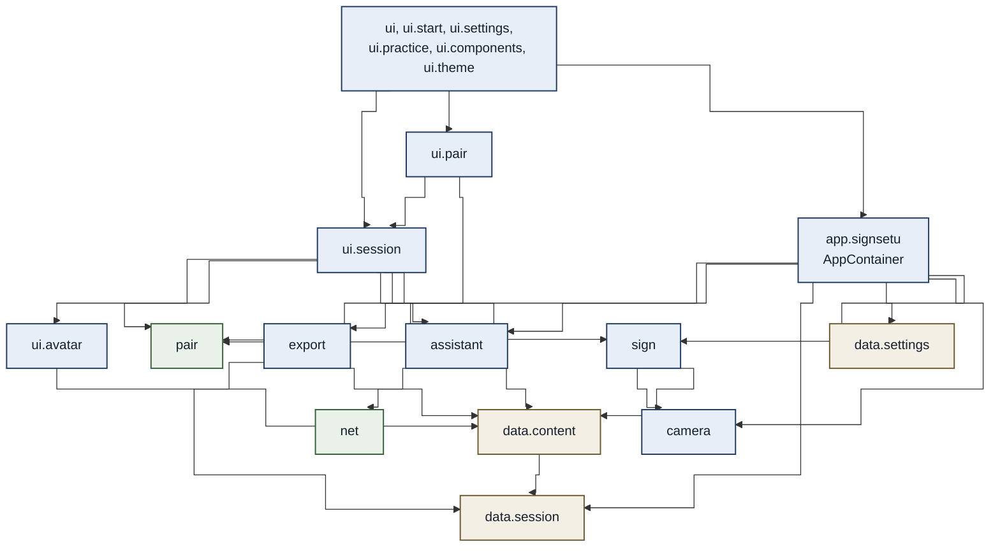

*Figure 5. Package dependencies, caller to callee. Interface packages sit on top; `pair`, `sign`, `camera`, `assistant` and the data packages never import an interface package.*

## 6. Content bundle

Everything a subject sees ships under `app/src/main/assets/content/` and is listed in `manifest.json` with its SHA-256; the manifest's own hash is the content version.

| Path | Content |
| --- | --- |
| `triage.json` | 15 question groups and 80 questions: phase, kind, condition (`after`), answer type, roles, profiles hidden from, text in 17 languages |
| `cards.json`, `cards/*.webp` | 12 categories, 117 picture cards (320 px WebP) |
| `lexicon.json` | 33 gesture-lookup entries (body location and hand action) |
| `gestures.json` | 42 authored everyday gestures |
| `signs.json` | 156 authored motions: 71 draft word signs, 26 Latin letters, 49 Hindi akshara and 10 digits |
| `isl_signs.json` | 415 ISL signs in 17 categories: 262 retargeted from INCLUDE signers, 153 from the ISLRTC dictionary |
| `asl_signs.json` | 286 ASL motions: words retargeted from PopSign signers plus the one-hand alphabet and digits |
| `words.json` | 226 vocabulary entries with 1,326 written forms, each to a sign, gesture or picture |
| `sign_words.json`, `asl_words.json` | Reader labels to vocabulary words (71 ISL, 67 ASL) and extra cards each label answers |
| `languages.json`, `subject_ui.json` | 17 languages; 46 stage words in each |
| `phrases.json`, `places.json` | 2 sentence patterns with 10 slots; 36 states and union territories, Chhattisgarh with 33 districts |
| `audio/<lang>/*.ogg`, `audio/greet/*.ogg` | 1,350 Opus recordings: 89 per language for 15 languages plus 15 greetings; Gondi and Halbi have none |
| `models/` | `holistic_landmarker.task` (13.7 MB) and its probe image; `sign_reader` (262 ISL words), `isl_spell` (36 letters and digits), `asl_reader` (250 ASL words), `asl_spell` (26 letters, CTC); each a `.bin` of float32 weights with a `.json` spec |

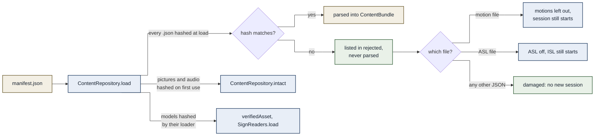

*Figure 6. How the bundle is verified. The officer sees a notice on the home screen for any rejected file.*

`tools/content/build_content.py --manifest-only` rewrites the manifest after normalising JSON to LF; `--check` exits 1 when it is stale; `tools/content/check_content.py` checks that every reference resolves and every label carries all 17 languages.

## 7. Session data

### 7.1 State and the event log

`SessionViewModel` combines the session row, its event flow and a private `Local` state into one `StateFlow<SessionUi>`. What is on the stage (`onStage`, with its logged row `itemId`) is kept apart from the officer's draft (`pending`), so a second screen never shows a draft. Landmark frames of signed answers stay in view-model memory only.

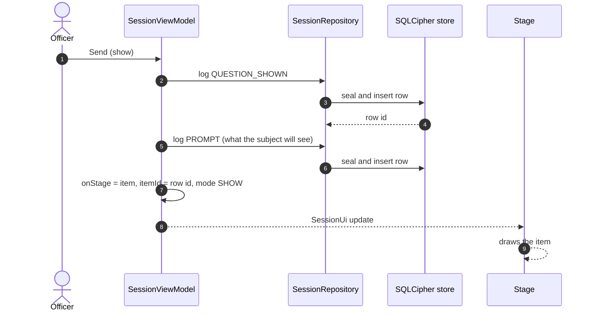

*Figure 7. Write before show: both rows are committed before the stage draws.*

### 7.2 Data model

Database version 5 (`SessionDatabase`); migrations 1 to 2 add the role, 2 to 3 add `itemId`, `reason`, `shownId` and `via`, 3 to 4 add the session title, 4 to 5 add the event hash. A downgrade drops the tables and tells the officer. No column is meant for a subject's name, address, phone number or photograph; the officer's name for a saved session and the subject's own lesson-sheet answers may hold such details and are encrypted like every row.

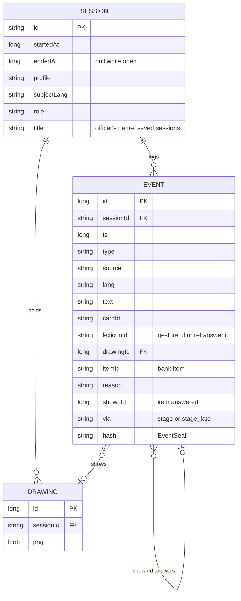

*Figure 8. Entity-relationship model of the session store.*

| Column | Values |
| --- | --- |
| `type` | QUESTION_SHOWN, ANSWER_CARD, ANSWER_DRAWING, ANSWER_GESTURE, ANSWER_UNCLEAR, ANSWER_TEXT, ANSWER_SIGNED, LANGUAGE_CHOSEN, NOTE, SYSTEM, SUGGESTED, APPROVED, SKIPPED, AUTO_ADVANCED, LINK, PROMPT |
| `source` | PRESET, TEXT, BOARD, SHOW_BACK, SUBJECT, OFFICER, PHRASE, RULE, MACHINE |
| `reason` | Auto-mode reasons; `rights_shown`, `caption_missing`, `opening`, `ai_counsellor` on shown rows; `given:<METHOD>:<0/1>` on lesson answers; `cue:<nod/shake/point/palm/shrug>` on taps that followed a proposed gesture; `evidence:skeleton` on a skeleton snapshot |

Readings by the app (`MACHINE`) and the officer (`OFFICER`) are their own rows, apart from the subject's answers; `grades` in `EvidenceGrade.kt` gives each answer line its grade (Said, Confirmed, Officer's reading, App's reading, Said no, Unclear).

### 7.3 Hash chain

Each row is sealed as it is written (`SessionRepository.log` under a mutex): its hash covers the previous row's hash, every field and the SHA-256 of its drawing. An edited, inserted or removed row breaks every later hash. Rows from before version 5 have no hash and are counted, not chained.

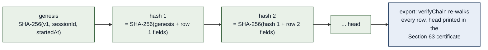

*Figure 9. The event hash chain (`EventSeal`, `EvidenceIntegrity.verifyChain`).*

### 7.4 Retention

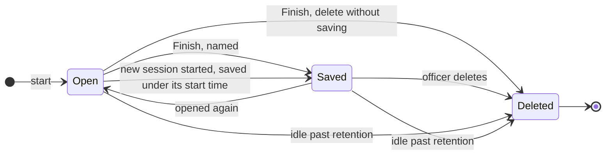

*Figure 10. Session lifecycle in the store. A rooted phone keeps no history: finishing deletes the session.*

Retention is 24 hours by default, 4 to 72 hours by choice, or 0 to keep sessions until deleted. A session is idle from its end, or while open from its last row. `RetentionWorker` runs hourly: while the app is unlocked it deletes idle sessions row by row (`purgeExpired`, also run at every unlock); while the app is locked the key cannot be used, so once even the newest session activity is past retention it destroys the keys and the database (`clearAllData`). `PRAGMA secure_delete` is on and the journal is truncated, so freed pages are zeroed and no write-ahead log keeps them.

## 8. Keys, unlock and relock

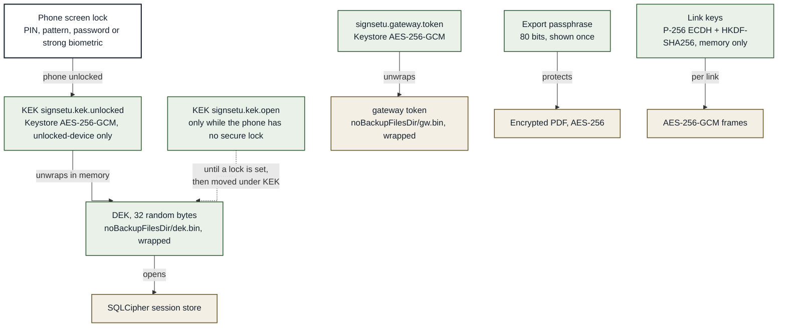

*Figure 11. Key hierarchy (`DatabaseKey`, `KeystoreVault`, `SessionReport`, `PairCrypto`).*

- The KEK needs no prompt but works only while the phone is unlocked. If Android invalidates it (the screen lock was removed or reset) or the wrapped DEK no longer opens, the database is deleted, new keys are made, and the officer is told once.
- `OfficerAuth` asks for the screen lock (`BIOMETRIC_STRONG or DEVICE_CREDENTIAL` on API 30 and later, device credential on API 29) before the store opens, a session is left, ended, exported or deleted, and before Clear all data. One confirmation covers the next 60 seconds. A phone with no secure lock skips the prompt.

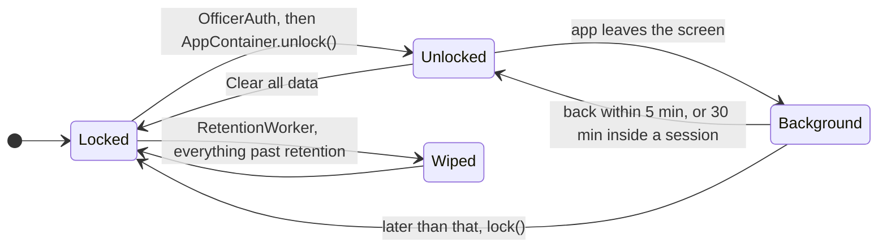

*Figure 12. Unlock and relock (`AppContainer`). `lock()` closes the store after a second, frees the models, ends an officer link and forgets the last confirmation.*

A build stops starting sessions 180 days after its build day; the app keeps the latest day it has seen, so turning the phone's date back does not help (`Policy.kt`).

## 9. Second screen

`AppContainer.link` holds at most one `StageLink`, this phone as officer or this device as the stage. All link logic runs on one single-threaded scope; blocking reads and writes go to the IO dispatcher.

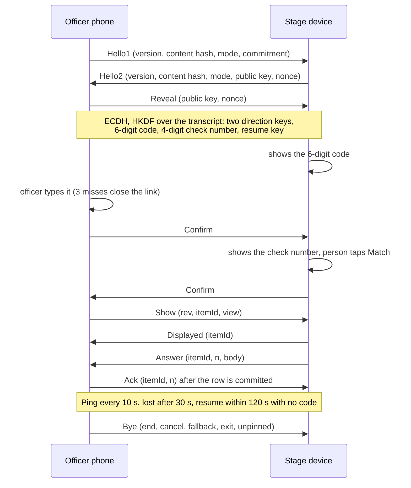

*Figure 13. Pairing and exchange (`PairCrypto`, `StageWire`, `StageLink`).*

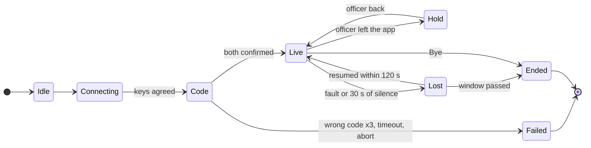

*Figure 14. `LinkState`. A stage that fails before Live goes back to waiting; an officer link shows why it failed.*

Frames are `u32 length | u64 counter | AES-256-GCM`; the IV is a direction byte and the counter, the receiver accepts only the next counter, handshake frames are capped at 4 KiB and encrypted frames at 1 MiB. The stage reads signs itself (`readSigns`, one word per sign) and sends words only; landmarks never cross the link. The officer phone re-encodes every drawing it receives, after bounding its size.

## 10. Assistant

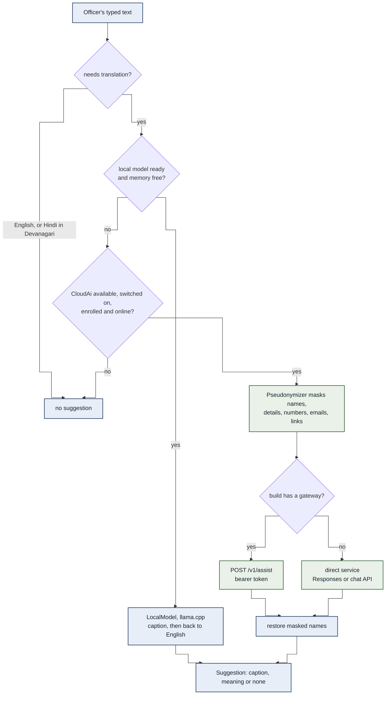

*Figure 15. Translation path (`Assistant.suggest`, `CloudAi.ask`).*

- **Local.** `ModelStore` imports a GGUF file and keeps it only if its SHA-256 is on `KNOWN_MODELS` (Gemma 3 1B Q4_K_M). It is offered on phones reporting at least 2.4 GB and loads only with 1.2 GB free; it is freed on lock, on memory pressure, and whenever the stage shows or a sign window opens. Each request starts from an empty 1,024-token context with greedy decoding.
- **Online.** `CloudAi` uses the gateway when the build has one: a one-time department code is traded at `/v1/enroll` for a token stored by `KeystoreVault`; a 401 clears it. Without a gateway it may use a direct service whose key is compiled in; a release build refuses that key unless `-PallowEmbeddedKey` is passed. Session data (the AI counsellor, the draft report) goes out only after the officer allows it once for the session. The gateway accepts only system prompts that match the app's own (`app_prompts.json`, written by `GatewayPromptContractTest`).
- **Without a network** the report falls back to `OfflineReport`, a rule-based draft marked "not part of the record", and follow-up questions to a fixed list.

## 11. Camera and sign reading

`CameraMirror` binds Preview and ImageAnalysis only (no capture or recording), both 16:9; analysis targets 848 by 480, rotated upright into a reused RGBA buffer. While the stage camera shows, frames are tracked in memory for the skeleton overlay and the gesture proposals: about every 30 ms with a person in view, every 250 ms after 10 s with nobody. Landmarks are kept only inside a sign window.

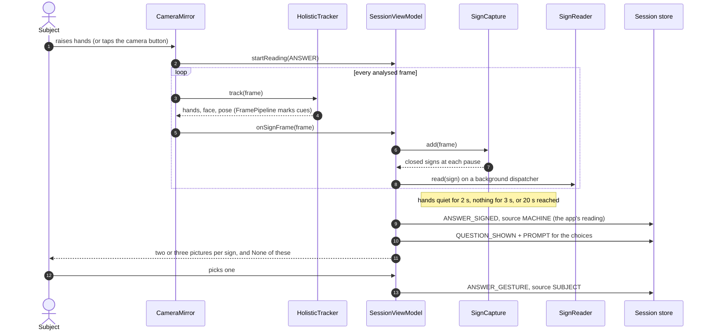

*Figure 16. A signed answer on this phone's stage. Only the subject's pick records a meaning.*

| Window | Opened by | Limit | Pause that ends a sign | Face points |
| --- | --- | --- | --- | --- |
| `ANSWER` | Raised hands on the call stage, the camera button, or Read signs | 20 s, or quiet hands for 2 s | 0.4 s | Kept |
| `NARRATIVE` | Tell me | 3 minutes, or quiet hands for 5 s | 0.7 s | Dropped |

`HolisticTracker` runs MediaPipe Holistic in video mode, GPU first and kept only if it finds the person in a bundled probe image, otherwise CPU. Readers: `sign_reader` (262 ISL words), `isl_spell` (letters and digits), `asl_reader` and the CTC `asl_spell`; a spelled read wins over the word reader only with steady wrists. Guesses that answer the item on screen rank first (`decideRead`). Signs the officer reads as a word the reader did not offer are matched for the rest of the session by dynamic time warping (`HomeSigns`).

## 12. Export

`SessionViewModel.exportReport` re-reads the rows from the store, re-walks the hash chain and builds the Section 63 certificate (`EvidenceIntegrity`); `SessionReport` draws A4 pages with `PdfDocument` (header, personal details given, optional machine draft summary, the conversation, a separate section for readings, drawings, the certificate), numbers every page with the record digest and chain head, and encrypts the file with PdfBox AES-256 under a 16-character passphrase from 32 symbols (80 bits) and a random owner password. The file waits in `cacheDir/exports` for the share sheet; files older than 15 minutes, and all of them at every unlock and on Clear all data, are deleted.

## 13. Build and delivery

- `applicationId` `in.signsetu`; code namespace `app.signsetu` (`in` is a Kotlin keyword). Version 0.7.2, code 12. Flavors `standard` (reference) and `nearby` (`.nearby` suffix, Play services).
- Release builds: R8 with resource shrinking, `android.util.Log` calls stripped, native libraries and models stored uncompressed. Default ABIs arm64-v8a and x86_64 (universal); `-Pabi=arm64-v8a` builds the phone APK. APKs are unsigned; signing is a manual offline step.
- Build gates on every variant before packaging: `check<Variant>Permissions` fails on RECORD_AUDIO or background location in any build and on discovery and location permissions in `standard`; `check<Variant>NoEmbeddedKey` fails a release that would compile in an assistant key.
- The gateway (`backend/`, FastAPI and SQLAlchemy, SQLite or PostgreSQL) enrols devices, serves the model manifest, and proxies assistant calls. Voluntary officer feedback and correction proposals undergo forensic team triage before any ML fine-tuning. The reviewer portal (`portal/`, Vite+, React 19, TypeScript 7) draws every motion with a TypeScript port of the rig checked against `Rig.kt` through `src/rig-fixtures.json`.
