# Sign Setu: Documentation

Sign Setu is an offline Android app that helps a police officer communicate with a person who cannot be reached in words: a child or adult who is deaf, non-verbal, frightened, or speaks another language. The officer and the person share the officer's phone, or the person uses a paired second screen. The app is a communication aid; it is not an interpreter and it does not record or take statements.

| Field | Value |
| --- | --- |
| Baseline | Application version 0.5.0 (version code 7), applicationId `in.signsetu` |
| Status | Baseline for departmental review |
| Classification | Internal, for review |
| Scope | Requirements, design, data protection, security controls, assurance, release and operation, with the data flow model and the architecture views |
| Source of truth | Repository `Yash-Awasthi/sign-setu`; requirements in `docs/01-requirements.md`, security controls in `04-security.md` |

## Contents

1. [Document set and conventions](#1-document-set-and-conventions)
2. [Overview](#2-overview)
3. [Data flow](#3-data-flow)
4. [Architecture](#4-architecture)
5. [Requirements, design and data protection](#5-requirements-design-and-data-protection)
6. [Security](#6-security)
7. [Quality assurance](#7-quality-assurance)
8. [Build, release and operation](#8-build-release-and-operation)
9. [Risks, limitations and traceability](#9-risks-limitations-and-traceability)
11. [Glossary](#glossary)

## 1. Document set and conventions

### 1.1 Build documents

| File | Contents |
| --- | --- |
| [01-requirements.md](01-requirements.md) | Purpose, users, subject profiles, constraints, functional and non-functional requirements, traceability |
| [02-architecture.md](02-architecture.md) | Technology, packages and flavor source sets, content bundle, data model, storage, export, build, performance, second-screen protocol, reviewer portal |
| [03-ux.md](03-ux.md) | Officer and stage states, profiles, flows, accessibility, visual and content style |
| [04-security.md](04-security.md) | Security controls (SEC-), keys, threats in scope |
| [05-avatar-and-gestures.md](05-avatar-and-gestures.md) | Gesture and ISL lexicons, the two characters, motion pipelines, the code-drawn rig, validation |
| [07-decisions.md](07-decisions.md) | Decision log (D-01 to D-54): context, choice, alternatives and consequences; changed only by adding a superseding entry |
| [09-open-source.md](09-open-source.md) | Reusable open-source components per module, with licences and attribution |
| [11-hand-model-integration.md](11-hand-model-integration.md) | The vision engine and sign reader, sign windows, and the contract for a replacement model |
| [12-on-device-assistant.md](12-on-device-assistant.md) | The optional on-device translation assistant: model, installation, budgets |
| [13-product-overview.md](13-product-overview.md) | One reference for explaining the product: features, mechanisms, character, sign reading, export, stack, frontend, readiness |
| [14-screens.md](14-screens.md) | Catalogue of every screen, with screenshots in [screens/](screens/) |
| [15-dpia.md](15-dpia.md) | Data protection impact assessment: processing, lawful basis, statutory recording and risks |
| [17-attestation-and-pinning.md](17-attestation-and-pinning.md) | Assessment and design for certificate pinning and Key Attestation: threat model, safeguards, unresolved decisions; not built |

### 1.2 Other folders

| Folder | Contents |
| --- | --- |
| [../portal/](../portal/README.md) | Reviewer portal for content sign-off (static web page; not shipped in the app) |

### 1.3 Conventions

- **[confirm]** marks anything that depends on a person or body outside the team.
- Legal summaries come from public sources and are not legal advice.
- Sizes in MiB are binary (1 MiB = 1,048,576 bytes); sizes in MB are decimal.
- Diagrams are Mermaid source. Connectors use the `step` curve, so every line runs horizontally or vertically.

## 2. Overview

### 2.1 Purpose and scope

Sign Setu is one Android application with no server.

**In scope:** officer panel; subject-facing stage with an animated character; questions, phrases and pictures in 17 languages; answers by touch, drawing, writing and signing to the camera; on-device sign recognition for Indian (ISL) and American (ASL) sign language; encrypted local session record; password-protected report; optional second screen over Bluetooth; reviewer portal for content sign-off.

**Out of scope:** statement recording, case management and identity capture. Online services are limited to the optional department gateway.

### 2.2 Stakeholders and users

| Role | Interest | Data flow model |
| --- | --- | --- |
| Police officer | Quick, defensible communication with the subject | E1 |
| Subject | To be understood without fear or confusion | E2 |
| Records custodian | A complete, protected record | E3 |
| Interpreter | Reached when a human interpreter is needed | E4 (contact link only) |
| Content reviewers | Correct signs, wording and child-safe content | Build pipeline, B3 |
| Release manager | Trustworthy releases; custody of the signing key | Build pipeline, B6, D8 |
| Security assessor | Verifiable controls | Section 6 |

Subject profiles decide what the subject sees and hears: young child, ISL user, hearing in another language, or not sure.

### 2.3 Session workflow

| Step | What happens |
| --- | --- |
| 1 Unlock | Device credential or strong biometric unlocks the app and the database key |
| 2 Set up | Officer picks profile, subject language (17), role, and ISL or ASL; the session is pinned to the screen |
| 3 Open | The stage greets the subject, then shows an introduction, ground rules and a practice round; each step needs only Next or Stop |
| 4 Ask | The officer shows prepared questions, phrases or pictures, or types text; typed English gets an instant Hindi caption marked unchecked |
| 5 Answer | The subject taps, draws, writes, uses a number pad or phrase board, or signs |
| 6 Confirm | A signed answer becomes two or three pictures per sign plus None of these; only the subject's tap records a meaning |
| 7 Record | Every event is written before the screen shows it; the officer sees how each answer was given |
| 8 End | Export an encrypted report, or end without export; data is purged and the database vacuumed |

### 2.4 Sign recognition

The camera is a mirror and records nothing outside a sign window. A sign window is opened by the subject's tap on Sign; it lasts 20 seconds for an answer and 3 minutes for an account. MediaPipe Holistic runs GPU first with CPU fallback. Readers: a 262-word ISL word reader, ISL and ASL spelling readers and an ASL word reader. The top three readings per sign, ranked by question context, are proposals only.

Process decomposition is in [section 3.4](#34-level-2-stage-interaction); the message sequence is in [section 4.5.1](#451-reading-a-signed-answer).

### 2.5 Reference configuration

| Item | Value |
| --- | --- |
| Target devices | Android 10 (API 29) or later, 64-bit (arm64-v8a phones; the universal build adds x86_64), 3 GB RAM or more, 5 to 6.9 inch portrait |
| Flavors | `standard` (reference, Bluetooth RFCOMM) and `nearby` (adds Nearby Connections) |
| Release package | Signed APKs: arm64-v8a for phones, 78.9 MiB, and universal (arm64-v8a and x86_64), 104.2 MiB; nothing compressed; float32 sign readers; native libraries stored uncompressed |
| Permissions (standard) | `CAMERA` (mirror and sign window), `BLUETOOTH_CONNECT` (second screen), `VIBRATE`. `INTERNET` only for the department gateway; no microphone or location (build gate) |
| Languages (17) | English, Hindi, Chhattisgarhi, Gondi, Halbi, Bengali, Nepali, Assamese, Odia, Tamil, Telugu, Kannada, Malayalam, Marathi, Gujarati, Punjabi, Urdu |

## 3. Data flow

This section is the data flow model of Sign Setu. It shows how data enters, moves through, is stored by and leaves the system, and where trust changes. The runtime system is one offline Android application; the build pipeline is modelled separately. Out of scope for Release 1 and therefore not drawn: any server, network call, speech service or cloud translation (Release 1.1 behind a project gateway).

### 3.1 Notation

Gane-Sarson conventions. Processes are numbered; data stores are prefixed D; flows carry a unique ID and are drawn as orthogonal connectors. Each child diagram balances with its parent: every flow crossing a parent process boundary appears in the child.

| Element | Drawn as |
| --- | --- |
| External entity | Rectangle, white fill |
| Process | Rounded box, blue fill, numbered |
| Data store | Cylinder, tan fill, prefixed D |
| Trust boundary | Labelled subgraph (`TB0` to `TB3`) |
| Data flow | Labelled arrow, unique ID (F, G or H) |

### 3.2 Context diagram (level 0)

The system and its six external entities.

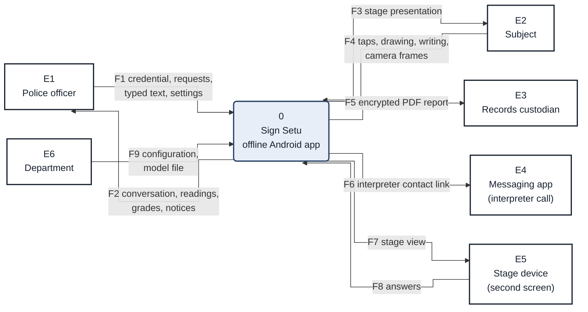

*Figure 1. Context diagram: the system and its six external entities.*

### 3.3 Level 1: runtime system

Level 1 is shown in three views so each stays legible. Processes 1.0 to 8.0 and stores D1 to D5 all sit inside TB1; flows F10 to F39 each appear in at least one view.

*Figure 2a. Level 1, view A: unlock, requests, translation and the session record.*

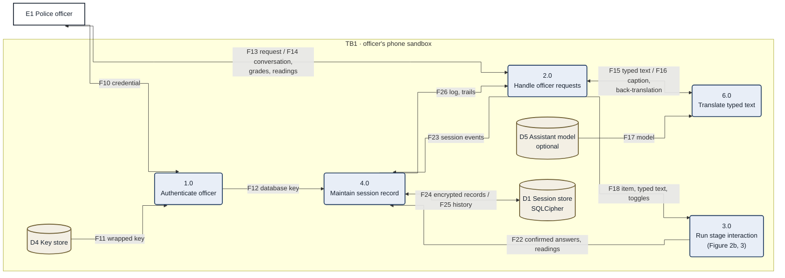

*Figure 2b. Level 1, view B: the stage and the second screen.*

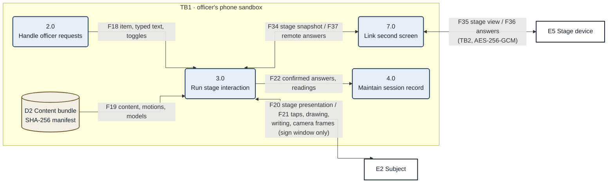

*Figure 2c. Level 1, view C: export, configuration and retention.*

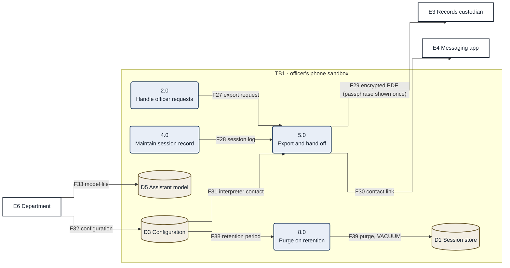

### 3.4 Level 2: stage interaction

The sign path: camera frames reach the tracker only inside a sign window, landmarks live in memory only, and a reading is only ever a proposal until the subject taps a picture (3.7, 3.8). Boundary flows G1, G17, G19 and G4 are F18, F37, F22 and F34 of Figures 2a and 2b.

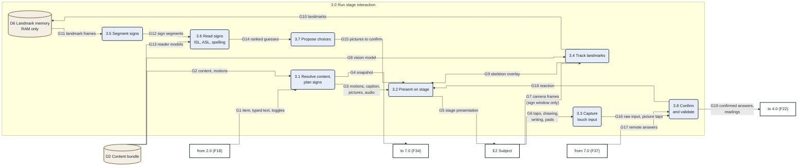

*Figure 3. Level 2 decomposition of 3.0.*

### 3.5 Build and review pipeline

Content reaches a phone only as a hashed bundle inside a signed APK.

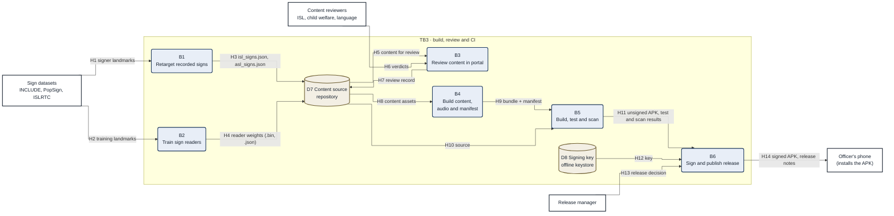

*Figure 4. Build, review and release.*

### 3.6 End-to-end view

One diagram for the whole system: how sign data and content are built and reviewed, how they ship inside the signed APK, and how, on the officer's phone, a question reaches the subject and the subject's answer, typed, tapped or signed, becomes a confirmed record. Everything inside TB1 runs on the phone with no network.

This view has its own numbering. Its processes 3.1 to 3.7 and entities E6 to E7 do not match the Level 1 and Level 2 numbers above; the IDs are local to this view.

```mermaid
%%{init: {"flowchart": {"curve": "step"}}}%%
flowchart LR
 subgraph TB2["TB2 · Bluetooth link"]
 E6["E6 Stage device<br/>optional second screen"]:::ent
 end
 subgraph TB0["TB0 · Stage on the shared screen"]
 P31("3.1<br/>Resolve content, plan signs"):::proc
 P32("3.2<br/>Present on stage"):::proc
 P33("3.3<br/>Capture input"):::proc
 P34("3.4<br/>Validate, subject confirms"):::proc
 P35("3.5<br/>Track landmarks"):::proc
 P36("3.6<br/>Read ISL word signs"):::proc
 P37("3.7<br/>Spelling, ASL, text"):::proc
 D6[("D6 Landmark memory<br/>RAM")]:::store
 end
 subgraph TB1["TB1 · Officer's phone, app sandbox"]
 P1("1.0<br/>Authenticate officer"):::proc
 P2("2.0<br/>Handle officer requests"):::proc
 P4("4.0<br/>Maintain session record"):::proc
 P5("5.0<br/>Export and hand off"):::proc
 P6("6.0<br/>Translate typed text"):::proc
 P7("7.0<br/>Link second screen"):::proc
 P9("9.0<br/>Purge on retention"):::proc
 D1[("D1 Session store<br/>SQLCipher")]:::store
 D2[("D2 Content bundle<br/>hashed")]:::store
 D3[("D3 Configuration")]:::store
 D4[("D4 Key store<br/>Keystore")]:::store
 D5[("D5 Assistant model<br/>GGUF")]:::store
 end
 subgraph BUILD["Build and review · developer workstation"]
 E8["E8 Sign datasets<br/>INCLUDE, PopSign ASL, ISLRTC dictionary, ISL alphabet set"]:::ent
 E9["E9 Content reviewers<br/>ISL, child welfare, language"]:::ent
 P81("8.1<br/>Retarget recorded signs"):::proc
 P82("8.2<br/>Train ISL sign reader"):::proc
 P86("8.6<br/>Train ASL and spelling readers"):::proc
 P83("8.3<br/>Review content in portal"):::proc
 P84("8.4<br/>Build content and manifest"):::proc
 P85("8.5<br/>Build signed APK"):::proc
 D7[("D7 Content source<br/>repository")]:::store
 end
 E1["E1 Police officer<br/>authenticates, asks, reads"]:::ent
 E2["E2 Subject<br/>deaf, non-verbal, other language"]:::ent
 E3["E3 Records custodian<br/>case file, CWC"]:::ent
 E4["E4 Messaging app<br/>interpreter call"]:::ent
 E7["E7 Department<br/>model file, contacts"]:::ent

 E8 -- "F01 signer landmarks" --> P81
 E8 -- "F02 training landmarks" --> P82
 E8 -- "F03 ASL words (PopSign), ISL and ASL letters" --> P86
 P81 -- "F04 isl_signs.json" --> D7
 P82 -- "F05 sign_reader.bin, .json" --> D7
 P86 -- "F06 asl_reader, asl_spell, isl_spell" --> D7
 D7 -- "F07 content for review" --> P83
 E9 -- "F08 verdicts" --> P83
 P83 -- "F09 review record" --> D7
 D7 -- "F10 content assets" --> P84
 P84 -- "F11 bundle + SHA-256 manifest" --> P85
 P85 -- "F12 signed APK" --> D2

 E1 -- "F13 credential" --> P1
 D4 -- "F14 key material" --> P1
 P1 -- "F15 database key" --> P4
 E1 -- "F16 officer request" --> P2
 P2 -- "F17 conversation, grades, readings" --> E1
 P2 -- "F18 typed text" --> P6
 P6 -- "F19 caption + back-translation" --> P2
 D5 -- "F20 model" --> P6
 E7 -- "F21 model file" --> D5
 E7 -- "F22 interpreter contact" --> D3
 P2 -- "F23 session events" --> P4
 P4 -- "F24 encrypted records" --> D1
 D1 -- "F25 history" --> P4
 P4 -- "F26 log, trails" --> P2
 D3 -- "F27 retention period" --> P9
 P9 -- "F28 purge" --> D1

 P2 -- "F29 item, typed text, toggles" --> P31
 D2 -- "F30 content, motions" --> P31
 D2 -- "F31 Holistic model" --> P35
 D2 -- "F32 reader models" --> P36
 P31 -- "F33 motions, caption, pictures, audio" --> P32
 P32 -- "F34 stage presentation" --> E2
 E2 -- "F35 taps, drawing, writing, pads" --> P33
 E2 -- "F36 camera frames, sign window" --> P35
 P35 -- "F37 skeleton overlay" --> P32
 P35 -- "F38 landmarks" --> D6
 D6 -- "F39 segments, replay" --> P36
 P36 -- "F40 top-3 per sign" --> P34
 P36 -- "F41 gloss stream" --> P37
 P37 -- "F42 words, letters, English and Hindi text" --> P34
 P34 -- "F43 choices to confirm" --> P32
 P33 -- "F44 raw input" --> P34
 P34 -- "F45 confirmed answers" --> P4

 P2 -- "F46 export request" --> P5
 P4 -- "F47 session log" --> P5
 P5 -- "F48 encrypted PDF report" --> E3
 P5 -- "F49 contact link" --> E4
 P31 -- "F50 stage snapshot" --> P7
 P7 -- "F51 stage view, AES-256-GCM" --> E6
 E6 -- "F52 answers" --> P7
 P7 -- "F53 remote answers" --> P34

 classDef ent fill:#ffffff,stroke:#16202e,stroke-width:2px,color:#16202e
 classDef proc fill:#e8eef7,stroke:#1f3a5f,stroke-width:2px,color:#16202e
 classDef store fill:#f3efe4,stroke:#6b5b2e,stroke-width:2px,color:#16202e
```

*Figure 5. End-to-end data flow for the whole system.*

### 3.7 Data dictionary

#### 3.7.1 External entities

| ID | Entity | Role |
| --- | --- | --- |
| E1 | Police officer | Holds the phone; unlocks the app, asks, reads the record, exports. |
| E2 | Subject | Person being helped; sees and hears the stage, answers by touch, drawing, writing or signing. |
| E3 | Records custodian | Receives the encrypted report through the Android share sheet, on the officer's action. |
| E4 | Messaging app | WhatsApp or Sandes; opened to a contact link for an interpreter call. No session data passes. |
| E5 | Stage device | Optional second phone or tablet showing the stage over bonded Bluetooth; stores nothing. |
| E6 | Department | Supplies configuration (interpreter contact, retention) and the optional assistant model file. |

#### 3.7.2 Processes

| ID | Process | Description | Code |
| --- | --- | --- | --- |
| 1.0 | Authenticate officer | Device credential or strong biometric opens the app; the Keystore key that unwraps the database key works only while the phone is unlocked. | MainActivity, AppContainer, data.session |
| 2.0 | Handle officer requests | Officer panel: question groups, phrase and picture boards, typed text, notes, dictionary, mode, role, tools. | ui.session, ui.start |
| 3.0 | Run stage interaction | Shows the item to the subject and collects and validates the answer (Figure 3). | ui.session (stage), ui.avatar, camera, sign |
| 4.0 | Maintain session record | Writes every event before the screen reflects it; reads history for the log, trails and grades. | data.session, SessionViewModel |
| 5.0 | Export and hand off | Composes the PDF report, encrypts it under a one-time passphrase, shares it; opens the interpreter contact link. | export |
| 6.0 | Translate typed text | Rule-based English to Hindi caption on the phone (reviewed text, sentence patterns, word by word); optional on-device model with back-translation. | data.content.Translate, assistant |
| 7.0 | Link second screen | Pairs by commit-then-reveal ECDH; sends the stage view and receives answers over AES-256-GCM frames. | pair, ui.pair |
| 8.0 | Purge on retention | Deletes sessions older than the retention period (24 hours by default) and runs VACUUM; no deletion if the officer chose to keep sessions until deleted. | data.session (WorkManager) |

#### 3.7.3 Processes of 3.0

| ID | Process | Description |
| --- | --- | --- |
| 3.1 | Resolve content, plan signs | Looks up the question, picture, motion and caption; plans typed text into signs, recorded signs first. |
| 3.2 | Present on stage | Draws the character, caption, held picture and answer inputs; plays speech. |
| 3.3 | Capture touch input | Taps, drawing, writing, number pads and the phrase board. |
| 3.4 | Track landmarks | MediaPipe Holistic on camera frames, only while a sign window is open. |
| 3.5 | Segment signs | Cuts the landmark stream into signs by pauses; keeps a skeleton for replay. |
| 3.6 | Read signs | ISL word reader, ISL and ASL spelling, ASL word reader; top three per sign. |
| 3.7 | Propose choices | Ranks guesses by question context; builds two or three pictures per sign plus None of these. |
| 3.8 | Confirm and validate | Only the subject's own tap makes a meaning the answer; checks the input and records the method. |

#### 3.7.4 Data stores

| ID | Store | Content | Classification |
| --- | --- | --- | --- |
| D1 | Session store | Encrypted Room database (SQLCipher): sessions, events, drawings. | Personal, restricted |
| D2 | Content bundle | Questions, cards, motions, audio, models; every file checked against the SHA-256 manifest. | Public content |
| D3 | Configuration | DataStore: language, retention, interpreter contact. No personal data. | Internal |
| D4 | Key store | Android Keystore: non-exportable key-encryption key, usable only while the phone is unlocked. | Secret |
| D5 | Assistant model | Optional GGUF file imported by the department; hash-checked. | Internal |
| D6 | Landmark memory | Hand, face and pose points of signed answers; view-model memory only, wiped on end, lock and clear. | Personal, volatile |
| D7 | Content source | Repository: content JSON, reader weights, review record. | Public |
| D8 | Signing key | Release keystore held offline by the release manager and a second custodian. | Secret |

#### 3.7.5 Data flows

Flows are grouped where they form one exchange. Classification: Personal = may identify or describe the subject; Secret = key material; Public = published content.

| Flow | Between | Name | Data | Classification |
| --- | --- | --- | --- | --- |
| F1, F2 | E1 / 0 | Officer input and output | Credential, requests, typed text, settings; conversation, readings, grades, notices | Personal |
| F3, F4 | 0 / E2 | Subject interaction | Stage presentation; taps, drawing, writing, camera frames | Personal |
| F5 | 0 to E3 | Report | AES-256 encrypted PDF; passphrase shown once to the officer | Personal, encrypted |
| F6 | 0 to E4 | Contact link | wa.me link or Sandes launch; contact only | Internal |
| F7, F8 | 0 / E5 | Second screen | Stage view and answers, AES-256-GCM, strict counters | Personal, encrypted |
| F9 | E6 to 0 | Configuration | Interpreter contact, retention, optional model file | Internal |
| F10 to F12 | E1, D4, 1.0, 4.0 | Unlock | Credential result; wrapped key; database key held in memory while unlocked | Secret |
| F13, F14 | E1 / 2.0 | Officer request and reply | Selected question, typed text, toggles; conversation with grades and trails | Personal |
| F15, F16 | 2.0 / 6.0 | Translation | English text; Hindi caption marked unchecked; back-translation | Personal |
| F17 | D5 to 6.0 | Model | GGUF weights | Internal |
| F18 | 2.0 to 3.0 | What to show | Item id, typed text, toggles | Personal |
| F19 | D2 to 3.0 | Content | Content, motions, vision and reader models | Public |
| F20, F21 | 3.0 / E2 | Stage traffic | Presentation; touch input and camera frames inside a sign window | Personal |
| F22 | 3.0 to 4.0 | Answers | Confirmed answers with method; the app's reading kept as a separate row | Personal |
| F23 | 2.0 to 4.0 | Events | Shown, suggested, skipped, notes, system rows | Personal |
| F24 to F26 | 4.0 / D1 / 2.0 | Record | Encrypted writes, history reads, log and answer trails | Personal |
| F27, F28 | 2.0, 4.0 to 5.0 | Export | Export request; session log | Personal |
| F29, F30, F31 | 5.0, D3 | Hand-off | Encrypted PDF; contact link; interpreter contact | Personal, encrypted |
| F32, F33 | E6 to D3, D5 | Department supply | Configuration; model file | Internal |
| F34 to F37 | 3.0 / 7.0 / E5 | Second screen | Stage snapshot, stage view, answers, remote answers | Personal, encrypted |
| F38, F39 | D3, 8.0, D1 | Retention | Retention period; purge and VACUUM | Internal |
| G1 to G19 | 3.0 internals | Stage interaction | Figure 3: content, presentation, camera frames, landmarks, segments, guesses, choices, confirmed answers | Personal |
| H1 to H14 | Build | Build and review | Figure 4: datasets, retargeted signs, reader weights, review record, bundle, APK | Public, secret (key) |

#### 3.7.6 Flows of the end-to-end view

The end-to-end view (section 3.6) uses flows F01 to F53 with the following meanings.

| Flow | From | To | Data |
| --- | --- | --- | --- |
| F01 | E8 Sign datasets | 8.1 | Signer landmarks |
| F02 | E8 Sign datasets | 8.2 | Training landmarks |
| F03 | E8 Sign datasets | 8.6 | ASL words (PopSign), ISL and ASL letters |
| F04 | 8.1 | D7 | `isl_signs.json` |
| F05 | 8.2 | D7 | `sign_reader.bin`, `.json` |
| F06 | 8.6 | D7 | `asl_reader`, `asl_spell`, `isl_spell` |
| F07 | D7 | 8.3 | Content for review |
| F08 | E9 Content reviewers | 8.3 | Verdicts |
| F09 | 8.3 | D7 | Review record |
| F10 | D7 | 8.4 | Content assets |
| F11 | 8.4 | 8.5 | Bundle and SHA-256 manifest |
| F12 | 8.5 | D2 | Signed APK |
| F13 | E1 Police officer | 1.0 | Credential |
| F14 | D4 | 1.0 | Key material |
| F15 | 1.0 | 4.0 | Database key |
| F16 | E1 | 2.0 | Officer request |
| F17 | 2.0 | E1 | Conversation, grades, readings |
| F18 | 2.0 | 6.0 | Typed text |
| F19 | 6.0 | 2.0 | Caption and back-translation |
| F20 | D5 | 6.0 | Model |
| F21 | E7 Department | D5 | Model file |
| F22 | E7 | D3 | Interpreter contact |
| F23 | 2.0 | 4.0 | Session events |
| F24 | 4.0 | D1 | Encrypted records |
| F25 | D1 | 4.0 | History |
| F26 | 4.0 | 2.0 | Log, trails |
| F27 | D3 | 9.0 | Retention period |
| F28 | 9.0 | D1 | Purge |
| F29 | 2.0 | 3.1 | Item, typed text, toggles |
| F30 | D2 | 3.1 | Content, motions |
| F31 | D2 | 3.5 | Holistic model |
| F32 | D2 | 3.6 | Reader models |
| F33 | 3.1 | 3.2 | Motions, caption, pictures, audio |
| F34 | 3.2 | E2 | Stage presentation |
| F35 | E2 | 3.3 | Taps, drawing, writing, pads |
| F36 | E2 | 3.5 | Camera frames, sign window |
| F37 | 3.5 | 3.2 | Skeleton overlay |
| F38 | 3.5 | D6 | Landmarks |
| F39 | D6 | 3.6 | Segments, replay |
| F40 | 3.6 | 3.4 | Top three per sign |
| F41 | 3.6 | 3.7 | Gloss stream |
| F42 | 3.7 | 3.4 | Words, letters, English and Hindi text |
| F43 | 3.4 | 3.2 | Choices to confirm |
| F44 | 3.3 | 3.4 | Raw input |
| F45 | 3.4 | 4.0 | Confirmed answers |
| F46 | 2.0 | 5.0 | Export request |
| F47 | 4.0 | 5.0 | Session log |
| F48 | 5.0 | E3 Records custodian | Encrypted PDF report |
| F49 | 5.0 | E4 Messaging app | Contact link |
| F50 | 3.1 | 7.0 | Stage snapshot |
| F51 | 7.0 | E6 Stage device | Stage view, AES-256-GCM |
| F52 | E6 | 7.0 | Answers |
| F53 | 7.0 | 3.4 | Remote answers |

### 3.8 Trust boundaries

Control definitions are in [section 6](#6-security).

| ID | Boundary | Controls |
| --- | --- | --- |
| TB0 | Stage on the shared screen | Pinned full screen; officer notes, log and machine readings never drawn; camera analysed only inside a sign window; landmarks in RAM only (D6); a machine reading becomes the subject's only when the subject picks it (3.8). |
| TB1 | Officer's phone, app sandbox | Storage (D1, 8.0); authentication (1.0, D4); no network platform content and model hashes (D2, D5). |
| TB2 | Bluetooth link to a stage device | (7.0): bonded devices, authenticated key agreement, encrypted frames; the stage device stores nothing. |
| TB3 | Build and release |: open licences only (CC BY 4.0, Apache-2.0, MIT), content review before release (B3), verified dependencies, CI scans, offline signing key (D8). |

## 4. Architecture

Context, logical, runtime, data, key and deployment views of the application, its reviewer portal and its delivery pipeline. Data movement and trust boundaries are in [section 3](#3-data-flow).

### 4.1 Notation

Arrows point from caller to callee or from source to destination and are drawn as orthogonal connectors. Fill indicates the element kind.

| Kind | Fill | Border |
| --- | --- | --- |
| Component (`comp`) | Blue | Dark blue |
| Data (`data`) | Tan | Brown |
| Security-relevant (`sec`) | Green | Dark green |
| External (`ext`) | White | Ink |

### 4.2 System context

Sign Setu is one Android application. It needs no server; an optional department gateway is used only when the build has one and the phone is online. Content, vision and sign-reader models ship in the signed APK; session data stays in an encrypted database until the officer exports or clears it. An optional second phone shows the stage over Bluetooth and stores nothing. A static reviewer portal supports content sign-off and is not part of the app.

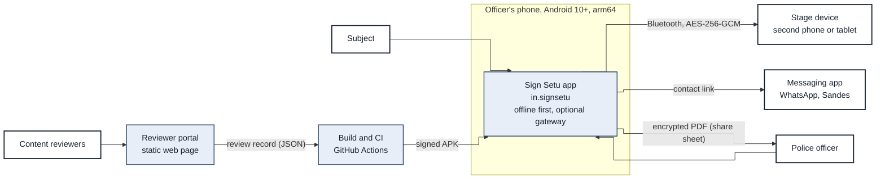

*Figure 1. System context: who and what interacts with the app, and the only paths out of the phone.*

### 4.3 Layered architecture

The interface never writes state directly: every action becomes an event written to the database first, and the screen updates from that write.

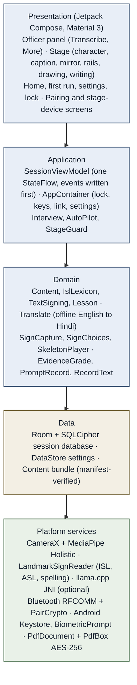

*Figure 2. Layers and the main component in each. Arrows point from caller to callee.*

### 4.4 Package map

One Gradle module, `app.signsetu`, organised by feature. Two product flavors on the transport dimension: `standard` (reference) and `nearby` (optional Nearby Connections).

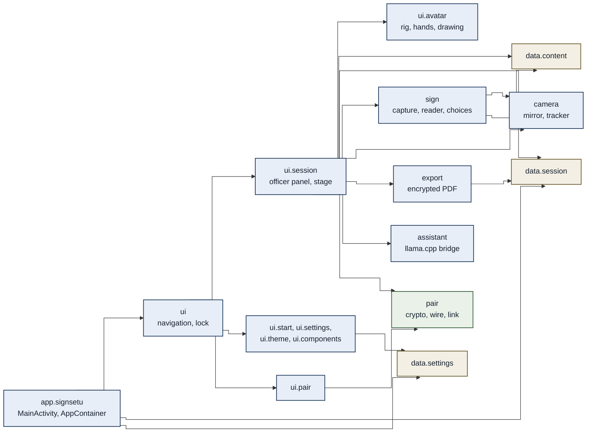

*Figure 3. Package dependencies. Interface packages depend downward; pair and export are reached only from the session UI.*

### 4.5 Runtime views

#### 4.5.1 Reading a signed answer

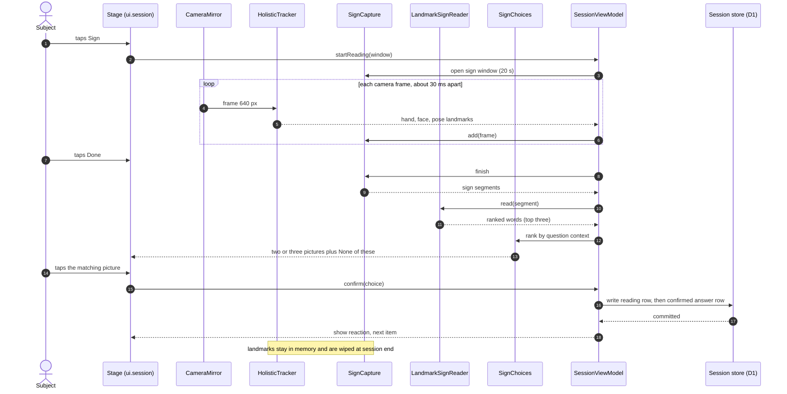

*Figure 4. Sequence for one signed answer. The reading is stored as a separate row from the subject's confirmed pick.*

#### 4.5.2 Session lifecycle

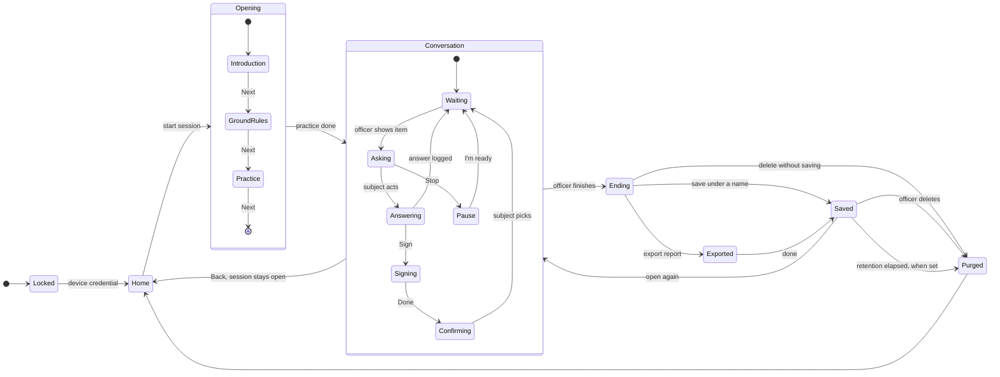

*Figure 5. Session states from unlock to purge. After the practice round the stage waits for the officer.*

#### 4.5.3 Second-screen pairing and exchange

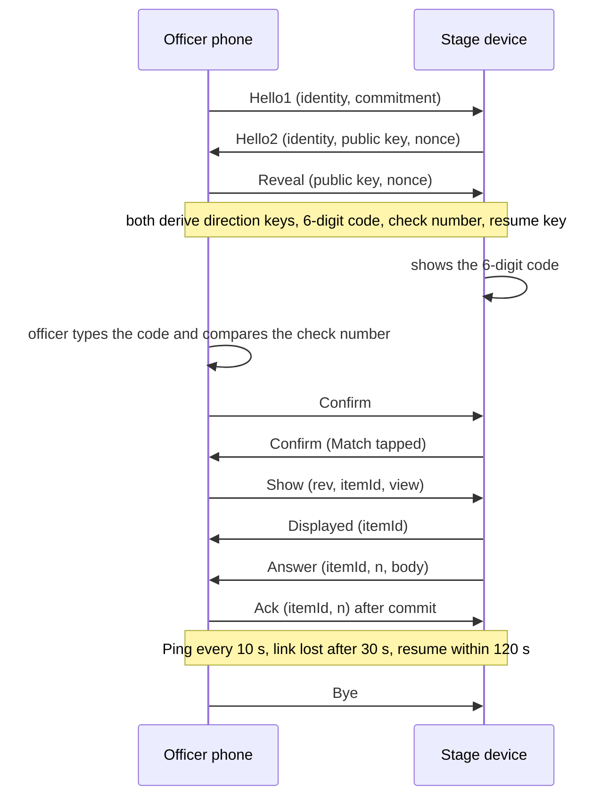

*Figure 6. Pairing and message flow over the encrypted Bluetooth link. The officer logs each item before Show and each answer before Ack.*

### 4.6 Data and keys

#### 4.6.1 Data model

No column is meant for a name, address, phone number or photograph; the officer's free-text name for a saved session may hold one and is encrypted like every row. Database version 4; a downgrade drops the tables and the officer is notified.

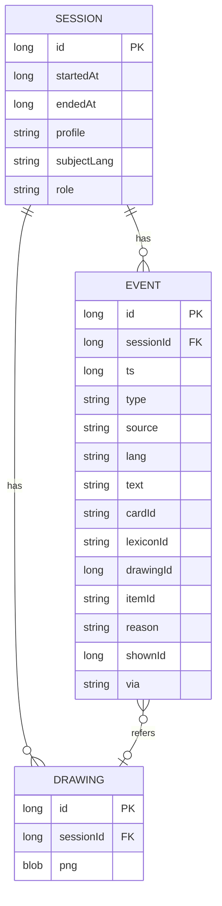

*Figure 7. Entity-relationship model of the session store.*

#### 4.6.2 Key hierarchy

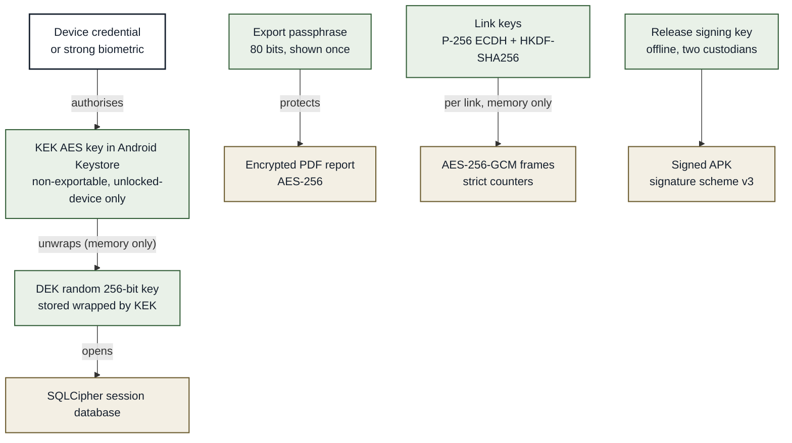

*Figure 8. Keys, where each lives and what it protects.*

### 4.7 Build, delivery and deployment

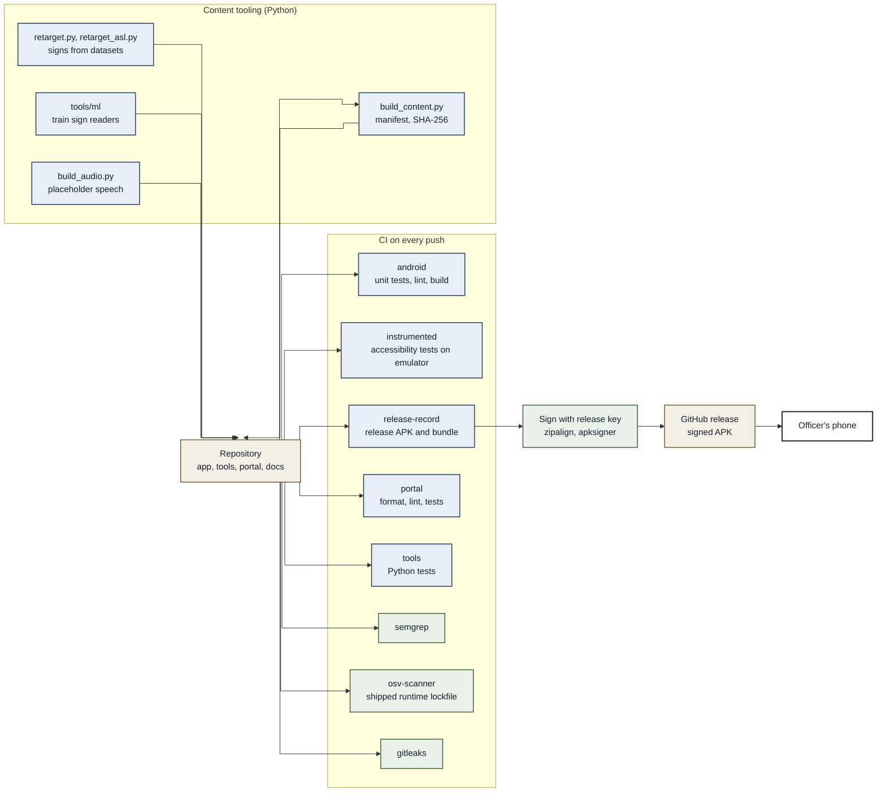

*Figure 9. Content tooling, CI gates, signing and release.*

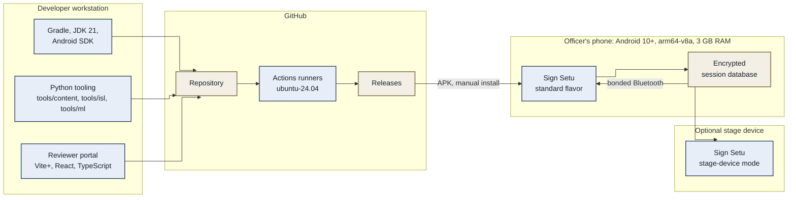

*Figure 10. Deployment view: where each part runs.*

### 4.8 Technology stack

| Layer | Choice | Reason |
| --- | --- | --- |
| Language, UI | Kotlin 2.4.21, Jetpack Compose (BOM 2026.09), Material 3 | Native build; direct access to Keystore and platform security APIs |
| Platform | minSdk 29, compileSdk and targetSdk 37; AGP 9.4.1 | Android 10 floor |
| Database | Room 2.8.5 with SQLCipher 4.19.1 | Encrypted at rest |
| Settings, work | DataStore 1.2.1, WorkManager 2.12 | No personal data; retention purge |
| Camera, vision | CameraX 1.6.2; MediaPipe Tasks Vision 1.1.1 (Holistic); protobuf-javalite 4.36.2 | Hands, face and pose on the phone; 64-bit only |
| Sign readers | LandmarkSignReader in plain Kotlin; float32 weights in the APK | No inference library to audit; nothing quantised |
| Characters | Compose Canvas 2D rig, keyframe motion files | No video; one motion file plays on both characters |
| Audio | Media3 ExoPlayer 1.11.1, Opus | Normal and reduced speed |
| Assistant | llama.cpp v0.5.0 via NDK and CMake (optional GGUF model) | Offline translation with back-translation |
| Export | PdfDocument, PdfBox-Android 2.0.27.0, BouncyCastle 1.86 | AES-256 encrypted report |
| Second screen | Bluetooth RFCOMM; Nearby Connections only in the `nearby` flavor | No network, scanning or location in the reference build |
| Build | Gradle 9.8.1, version catalog, R8 full mode, dependency verification, lockfile | Supply-chain control; nothing compressed for size |
| Portal | Vite+, React 19, TypeScript 7 | Static, no backend |

### 4.9 Quality attributes and tactics

| Attribute | Tactic |
| --- | --- |
| Confidentiality | Key hierarchy (Figure 8); sandbox with no network permission |
| Integrity of meaning | Machine readings are proposals; only the subject's tap makes an answer; evidence grades keep what was shown and how it was given |
| Auditability | Write before show; every event, method and shown item is recorded; the report carries the not-a-statement notice |
| Supply chain | Lockfile and verification metadata, content manifest hashes, signed APK, CI scans |
| Performance | Camera analysis only inside a sign window; each model loaded and checked on first use |
| Accessibility | 48 dp targets, 4.5:1 contrast, 200% font scale, TalkBack, automated accessibility checks in CI |
| Availability offline | No server dependency; every asset ships in the APK; each optional asset degrades alone |

### 4.10 Content bundle structure

All content is data, not code, and every file except `models/` is checked against `manifest.json` (SHA-256) each time the bundle loads. A file that fails its hash is never parsed or shown. A failed picture, recording or motion file is left out; any other failed JSON file stops new sessions. Each model is checked by its own loader on first use. Each ASL asset is optional and degrades alone.

| Path | Content |
| --- | --- |
| `triage.json` | 15 question groups, 78 questions with text per language, cards, roles |
| `cards.json`, `cards/*.webp` | 12 categories, 117 picture cards |
| `gestures.json`, `signs.json` | 42 authored gestures; letters, digits and draft word signs |
| `isl_signs.json`, `asl_signs.json` | 262 ISL and 250 ASL recorded signs retargeted from INCLUDE, ISLRTC and PopSign signers |
| `words.json`, `lexicon.json` | 222 vocabulary entries; 33 gesture-lookup entries |
| `languages.json`, `subject_ui.json` | 17 languages in their own scripts; stage words per language |
| `phrases.json`, `places.json` | Sentence patterns; 36 states and union territories |
| `audio/<lang>/*.ogg` | Placeholder speech, Opus, mono (1,350 files) |
| `models/` | Holistic landmarker, ISL word reader, ISL and ASL spelling readers, ASL word reader |

## 5. Requirements, design and data protection

### 5.1 Requirements

Requirements are numbered and traced to controls, tests and decisions. The register is [01-requirements.md](01-requirements.md).

| Category | Count | Examples |
| --- | --- | --- |
| Functional (FR) | In the register | Write before show; show-back confirmation; the subject owns meaning |
| Non-functional (NFR) | 26 | Start under 2 s; phone APK under 100 MB; touch targets 48 dp |
| Security (SEC) | 47 controls | Screen capture blocked; landmarks in RAM only |

#### 5.1.1 Key non-functional targets

| Target | Verified by |
| --- | --- |
| Cold start to usable officer state under 2 s | Device timing on the oldest test device |
| Preset question on the stage within 300 ms | Device timing; item logged then drawn |
| APK under 100 MB at full precision, nothing compressed | Release build size check |
| Memory under 300 MB per session | Profiler on device |
| Touch targets, contrast, 200% font scale, TalkBack | Espresso accessibility checks (CI), manual TalkBack pass |
| Encryption at rest, credential, no screenshots, no backup, no network, no analytics | Build gate, SEC tests, code review |

### 5.2 Design

#### 5.2.1 Principles

- **Offline first.** No feature depends on a network; online use is optional and falls back on any failure.
- **Content is data.** Questions, cards, translations and motions are versioned asset files under review, not code.
- **Write before show.** The database is written first; the screen follows.
- **The subject owns meaning.** A reading is a proposal; the subject's tap is the answer.
- **Small and boring.** One module, platform libraries first, no frameworks the audit must justify.

#### 5.2.2 Technology choice: Kotlin and Jetpack Compose

Native Kotlin was chosen over cross-platform frameworks because the product is a camera-and-security application: it runs MediaPipe and the sign readers on every frame, ships native C++ libraries, must declare no INTERNET permission, and relies on Android Keystore, SQLCipher, BiometricPrompt, screen pinning and FLAG_SECURE. Each of these is first-class in Kotlin and would need a native bridge elsewhere. The cost is that an iOS version would be a rewrite; the app targets officers' Android phones.

#### 5.2.3 Content and localisation

| Aspect | Design |
| --- | --- |
| Bundle | Structure, counts and integrity rules: [section 4.10](#410-content-bundle-structure) |
| Subject text | Every stage word, question, phrase and picture label exists in all 17 languages; speech exists for English, Hindi and most others as placeholder voices; Gondi and Halbi have none |
| Hindi caption | Typed English is captioned on the phone: reviewed wording first, then sentence patterns, then word by word; returns nothing rather than a wrong modal verb |
| Review | Every sign and question passes the reviewer portal before release; drafts are labelled |

#### 5.2.4 Design decisions

Each decision, with its alternatives, is recorded in [07-decisions.md](07-decisions.md).

### 5.3 Data and privacy

| Data | Where | Retention | Exit |
| --- | --- | --- | --- |
| Session events, drawings, typed answers | Encrypted database (D1) | Purged after 24 h by default, or a set period of 4 to 72 h; kept under the officer's name until deleted only if the officer chooses | Encrypted PDF only, on officer action |
| Landmarks of signed answers | View-model memory (D6) | Wiped at end, lock and clear | None |
| Camera frames | Memory, inside a sign window | Not stored | None |
| Settings, interpreter contact | DataStore | Until cleared | None |
| Export passphrase | Shown once on screen | Not stored | Officer shares it separately |

The database has no column for the subject's name, address, phone number or photograph. Lesson-sheet answers can hold such details; they live in the same encrypted rows and reach only the encrypted report.

- No analytics, advertising or crash-reporting SDK; MediaPipe usage statistics are blocked at build time.
- Every exported page carries a notice that the report is not a statement.

#### 5.3.1 Legal and policy context

DPDP Act 2023 and Rules 2025; Juvenile Justice Act 2015 section 74; POCSO Act sections 24 and 26; BNSS sections 38, 47, 48, 53, 58, 173 and 183; BSA section 125; Constitution Article 20(3); RPwD Act with IS 17802. Rights notices are shown to the subject as statements; a Yes under a right is never offered. The department confirms the application identifier and the legal wording before production.

## 6. Security

Objectives: subject data is unreadable without the officer's credential; it does not leak through backups, screenshots, logs, notifications, the clipboard or other apps; only an encrypted report or a contact link leaves the phone, on explicit action; every release is built from reviewed code, scanned and traceable.

| Family | Controls (summary) |
| --- | --- |
| Storage | SQLCipher database; DEK wrapped by a Keystore KEK; no backup; purge with VACUUM; drawings only inside the database |
| Cryptography | Platform and SQLCipher cryptography only; AES-256 report with an 80-bit one-time passphrase and a record digest on every page; P-256 ECDH, HKDF-SHA256, AES-256-GCM link frames |
| Authentication | Secure device lock required; BiometricPrompt (strong biometric or device credential); KEK usable only while the phone is unlocked |
| Network | HTTPS to the one gateway host only, cleartext refused; the build fails if any variant's merged manifest declares RECORD_AUDIO; no WebView |
| Platform | FLAG_SECURE; only the launcher exported; overlay-touch filter; screen pinning; no notifications with subject data; no clipboard of session data |
| Camera and landmarks | Analysis only in a sign window; landmarks in RAM; narratives drop face points |
| Supply chain | Dependency lockfile and verification metadata; SBOM; Lint, semgrep, osv-scanner, gitleaks; content manifest checked before use; offline signing key |
| Resilience | R8 full mode; rooted or test-key device (heuristic, evadable) warns the officer, lists no saved sessions and deletes a session when it is finished (department to confirm); build expiry 180 days; unreadable database deleted on key loss |
| Second screen | Bonded devices only; commit-then-reveal; typed code and check number; stage device stores nothing |

### 6.1 Threats addressed

| Threat | Main control |
| --- | --- |
| Lost, stolen or seized phone | Encrypted store and credential; retention purge |
| Screenshot, recording, recents thumbnail | FLAG_SECURE |
| Rogue or relayed second screen | Commit-then-reveal pairing, check number, AEAD frames |
| Machine reading taken as the subject's answer | Subject confirmation; evidence grades |
| Compromised dependency or key | Lockfile, verification metadata, scans, offline signing key |
| App used as a statement-taking tool | No statement feature; not-a-statement notices |

## 7. Quality assurance

### 7.1 Strategy

- Unit tests for content, logic, record, crypto, translation and sign pipeline (JVM, both flavors).
- Instrumented tests on an Android 14 emulator: stage accessibility in light and dark themes, end-to-end stage flow, migrations, export.
- Pipeline test on device: real dictionary clips through MediaPipe, segmentation and the reader.
- Portal tests (React, TypeScript) and Python tool tests for the build tooling.
- Security gates in CI: semgrep, osv-scanner on the shipped runtime lockfile, gitleaks.

### 7.2 Continuous integration

Every push to `main` runs these jobs.

| Job | Checks |
| --- | --- |
| android | Unit tests, release lint, release and nearby builds |
| instrumented | Stage accessibility, overlay-touch, database migration and report export tests on an API 34 pixel_6 emulator. Not run in CI: the end-to-end stage test (needs a camera feed) and the two MediaPipe pipeline tests (need a GPU); run them on a phone or a local emulator |
| release-record | Release APK and bundle, dependency and vulnerability record |
| portal, tools | Portal format, lint and tests; Python tool tests |
| semgrep, osv, gitleaks | Code patterns, known vulnerabilities in shipped libraries, secrets |

### 7.3 Results at this baseline

| Measure | Result |
| --- | --- |
| CI | All eight jobs pass on the baseline commit |
| Unit tests | 201 per flavor passed locally; instrumented suite passed locally (76 of 76 at last full run) |
| Portal tests | 918 passed |
| Release smoke test | Signed 0.5.0 APK installs and runs on an arm64 phone and on the emulator without a crash |
| Pipeline test (3 dictionary clips) | Hands and pose tracked in line with the desktop run; each clip segmented; true word in the top three for 2 of 3 clips |

### 7.4 Sign reader accuracy

Measured values, not targets.

| Reader | Data | Top-1 | Top-3 |
| --- | --- | --- | --- |
| ISL words (262) | Signers seen in training (n=816) | 0.979 | 0.995 |
| ISL words | A new signer, ISLRTC dictionary clips (n=199) | 0.286 | 0.442 |
| ASL words | Held-out PopSign signers | 0.402 | n/a |
| ISL letters, digits | Real signers, small samples (n=23 letters, n=10 digits) | 0.13 letters, 0.80 digits | 0.30, 1.00 |

The reader generalises poorly to people it has not seen. For that reason a reading is never recorded as an answer, every signed answer is confirmed by the subject from pictures, and the officer sees both the reading and the confirmation. Closing the gap needs recorded signs from many real signers, including children and the core answer words (yes, no, water, pain, help, stop, don't know).

## 8. Build, release and operation

### 8.1 Build and configuration management

| Topic | Practice |
| --- | --- |
| Source control | Git; `main` is the integration branch; the repository is public |
| Reproducibility | Gradle wrapper, version catalog, dependency lockfile and checksum verification; vendored llama.cpp at a pinned version; `.gitattributes` forces LF so manifest hashes hold on every checkout |
| Release build | R8 full mode with resource shrinking, not debuggable, log calls stripped; a universal APK (arm64-v8a and x86_64) and an arm64-v8a phone APK (`-Pabi=arm64-v8a`); zipalign and apksigner with the release key (signature scheme v3). The key is held offline by the release manager and a second custodian |
| Versioning | Semantic version in `app/build.gradle.kts` (0.5.0, code 7); a build refuses new sessions 180 days after its build date |
| Distribution | GitHub release asset for pilots; Mobile Seva AppStore or a department download page for production |

### 8.2 Installation and operation

| Topic | Guidance |
| --- | --- |
| Install | Allow installs from the source, open the APK, accept the camera permission. The phone must have a screen lock; the app refuses to store sessions without one |
| Use | Unlock, choose profile and language, start. The officer holds the phone with the stage facing the subject |
| Export | Finish session, name it, Export report, share the PDF, then give the one-time passphrase by a different channel; the session stays saved until the retention period ends |
| Update | Install the newer APK over the old one; updates must carry the same signing key |
| Shared phone risk | End each conversation; rely on retention; a department PIN can be added if the pilot shows shared phones |

## 9. Risks, limitations and traceability

### 9.1 Risks, limitations and open items

| Item | Impact | Mitigation or action |
| --- | --- | --- |
| Sign reader accuracy on unseen signers | Wrong proposals | Subject confirmation from pictures; evidence grades; collect real signer data |
| Translations beyond English and Hindi are drafts | Wrong wording shown to a subject | Labelled draft; native-speaker review before production |
| Gondi and Halbi have low confidence and no speech | Weak support for these languages | Review with speakers; record voices |
| Placeholder speech is synthetic | Unnatural voices | Replace with recorded speech |
| Hindi caption patterns are rules, not a model | Odd sentences for unusual input | No caption is better than a wrong one; marked unchecked; extend patterns after review |
| Android only, 64-bit only | No iOS or 32-bit phones; the universal APK (104.2 MiB) exceeds the 100 MB target, the phone APK meets it | Accepted scope for officers' phones |
| Not yet tested with children and on a spread of phones | Unknown field behaviour | Pilot devices and user testing |
| Signing key password handling | Key custody | Rotate the keystore password; keep the file offline |
| Formal reviews outstanding | No assurance claim yet | Content review record sign-off; CERT-In empanelled audit; MASVS review |

### 9.2 Traceability

| Area | Design | Verification |
| --- | --- | --- |
| Session record | SessionViewModel, data.session, ER model (Figure 7) | LogicTest, ConversationE2ETest, SessionMigrationTest |
| Stage and answers | ui.session stage, ui.avatar | StageLogicTest, StageAccessibilityTest |
| Sign recognition | camera, sign (Figure 4) | SignReaderTest, SignIngestionTest, SegmentTest, SignPipelineDeviceTest |
| Export | export (Figure 8) | ReportExportDeviceTest |
| Second screen | pair (Figure 6) | PairCryptoTest, two-device protocol test |
| Security | Layers, key hierarchy, DFD trust boundaries | Permission gate, CI scans, security tests |
| Translation | data.content.Translate | TranslateTest |

## Glossary

| Term | Meaning |
| --- | --- |
| Subject | The person the officer is helping |
| Session | One conversation, from start to end or purge |
| Officer state, Show state | The phone held by the officer, or facing the subject with the stage full screen |
| Stage | The subject's screen: character on top, camera window and answer rails below |
| Stage device | A paired second phone or tablet that shows the stage and stores nothing |
| Subject profile | Young child, ISL user, hearing with another language, or not sure; decides what the subject sees and hears |
| Gesture lexicon | Reviewed iconic, culturally common gestures for people who do not sign |
| Recorded sign | An ISL sign retargeted onto the characters from a Deaf signer's recorded landmarks (INCLUDE) |
| Lesson-sheet question | A personal-details question whose answer is entered on its own input on the stage |
| Show-back | Showing a candidate meaning to the subject, who picks it among alternatives or answers Yes or No, before it is logged as theirs |
| Sign window | The only time camera frames are analysed: a 20-second answer or a 3-minute account |
| Landmarks | Hand, face and pose points found in a frame; the only camera-derived data ever held |
| Reading | The app's machine guess at a sign; never an answer until the subject confirms |
| Evidence grade | Said, Confirmed, Officer's reading, App's reading, Said no or Unclear, on every answer line |
| Role | Not known yet, victim or witness, or accused or in custody |
| Draft | Content or translation not yet signed off by a native-language or Deaf reviewer |
| ISL, ASL | Indian Sign Language; American Sign Language |
| DEK, KEK | Database key; key-encryption key held in Android Keystore |
| BNSS, BSA | Bharatiya Nagarik Suraksha Sanhita 2023; Bharatiya Sakshya Adhiniyam 2023 |
| CWC | Child Welfare Committee |
| SJPU | Special Juvenile Police Unit |
| DPDP | Digital Personal Data Protection Act 2023 and Rules 2025 |
| MASVS | OWASP Mobile Application Security Verification Standard |
