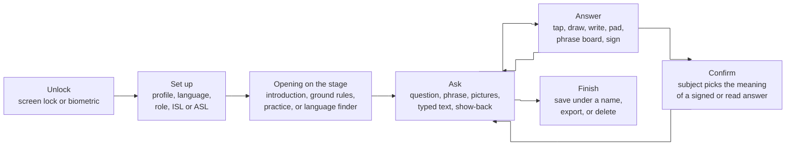
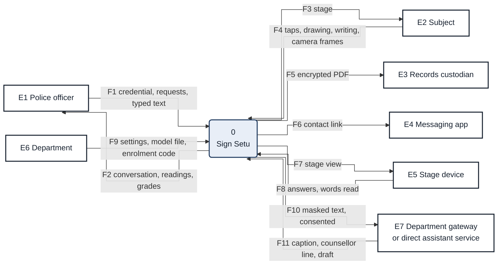
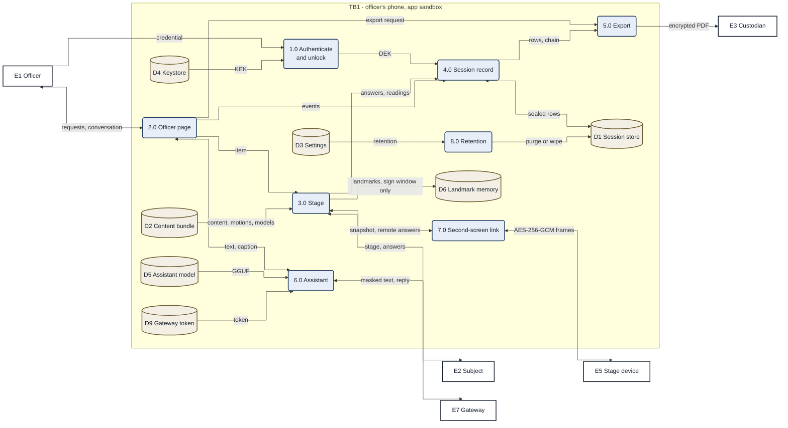

# Sign Setu: Documentation

Sign Setu is an offline Android app that helps a police officer communicate with a person who cannot be reached in words: a child or adult who is deaf, non-verbal, frightened, or speaks another language. The officer and the person share the officer's phone, or the person uses a paired second screen. The app is a communication aid; it is not an interpreter and it does not take statements.

| Field | Value |
| --- | --- |
| Version | 0.6.0 (version code 9), applicationId `in.signsetu` |
| Classification | Internal |
| Source of truth | This repository; the code wins over any document, and documents are corrected when they drift |

## Contents

1. [Document map](#1-document-map)
2. [Overview](#2-overview)
3. [Data flow](#3-data-flow)
4. [Quality assurance](#4-quality-assurance)
5. [Build, release and operation](#5-build-release-and-operation)
6. [Limitations](#6-limitations)
7. [Glossary](#7-glossary)

## 1. Document map

| File | Contents |
| --- | --- |
| [01-requirements.md](01-requirements.md) | Purpose, users, profiles, constraints, functional and non-functional requirements |
| [02-architecture.md](02-architecture.md) | Context, wiring, routing, packages, content bundle, data model, hash chain, keys, second screen, assistant, camera, export, build |
| [03-ux.md](03-ux.md) | Officer and stage screens, flows, accessibility, visual and content style |
| [04-security.md](04-security.md) | Security controls, MASVS mapping, threat model, key management, review points |
| [05-avatar-and-gestures.md](05-avatar-and-gestures.md) | Gesture and sign lexicons, the two characters, the rig, motion pipelines |
| [06-hardware-baseline-protocol.md](06-hardware-baseline-protocol.md) | Android 10 ARM64 benchmark procedure and thresholds |
| [08-two-device-bluetooth-test.md](08-two-device-bluetooth-test.md) | Two-device pairing and recovery test |
| [09-open-source.md](09-open-source.md) | Open-source components, licences and attribution |
| [11-hand-model-integration.md](11-hand-model-integration.md) | Vision engine, sign readers, sign windows, and the contract for a replacement model |
| [12-on-device-assistant.md](12-on-device-assistant.md) | The translation assistant, local and online |
| [13-product-overview.md](13-product-overview.md) | Feature reference for explaining the product |
| [14-screens.md](14-screens.md) | Every screen, with screenshots in [screens/](screens/) |
| [15-dpia.md](15-dpia.md) | Data protection impact assessment |
| [17-attestation-and-pinning.md](17-attestation-and-pinning.md) | Certificate pinning and Key Attestation design for the gateway |
| [../portal/README.md](../portal/README.md) | Reviewer portal for content sign-off |
| [../backend/README.md](../backend/README.md) | Department gateway |
| [../tools/ml/README.md](../tools/ml/README.md), [../tools/isl/README.md](../tools/isl/README.md) | Sign reader training and sign retargeting |

Conventions: **[confirm]** marks anything that depends on a person or body outside the team; legal summaries come from public sources and are not legal advice; MiB is binary and MB decimal; diagrams are Mermaid source.

## 2. Overview

### 2.1 Scope

**In scope:** officer page; subject-facing stage with an animated character; questions, phrases and pictures in 17 languages; answers by touch, drawing, writing and signing to the camera; on-device sign reading for Indian (ISL) and American (ASL) sign language; an encrypted, hash-chained session record; a password-protected report with a draft BSA s.63 certificate; an optional second screen over Bluetooth; an optional online assistant through the department gateway; a reviewer portal for content sign-off.

**Out of scope:** statement recording, case management, identity capture, audio or video recording.

### 2.2 Users

| Role | Interest |
| --- | --- |
| Police officer | Quick, defensible communication with the subject |
| Subject | To be understood without fear or confusion |
| Records custodian | A complete, protected record |
| Interpreter | Reached through a contact link when a human interpreter is needed |
| Content reviewers | Correct signs, wording and child-safe content |
| Department IT and release manager | Gateway, keys, distribution |

### 2.3 Session workflow

*Figure 1. One session. Every step is written to the encrypted record before the screen changes.*

### 2.4 Reference configuration

| Item | Value |
| --- | --- |
| Devices | Android 10 (API 29) or later, 64-bit, 3 GB RAM or more, 5 to 6.9 inch portrait |
| Flavors | `standard` (reference, Bluetooth RFCOMM) and `nearby` (adds Google Nearby Connections) |
| Release packages | Universal (arm64-v8a and x86_64) and arm64-v8a phone APKs, unsigned until the release step; native libraries and models stored uncompressed |
| Permissions (standard) | `CAMERA`, `BLUETOOTH_CONNECT` (`BLUETOOTH` up to API 30), `USE_BIOMETRIC`, `VIBRATE`, `INTERNET` (gateway or direct assistant only). No microphone and no location: a build gate fails the build otherwise |
| Languages (17) | English, Hindi, Chhattisgarhi, Gondi, Halbi, Bengali, Nepali, Assamese, Odia, Tamil, Telugu, Kannada, Malayalam, Marathi, Gujarati, Punjabi, Urdu |

## 3. Data flow

Gane-Sarson conventions: processes numbered, data stores prefixed D, trust boundaries TB0 to TB3. The architecture behind each process is in [02-architecture.md](02-architecture.md).

### 3.1 Context (level 0)

*Figure 2. Context: the system and its seven external entities.*

### 3.2 Level 1

*Figure 3. Level 1: processes and stores on the officer's phone.*

| Store | Content | Classification |
| --- | --- | --- |
| D1 Session store | SQLCipher Room database: sessions, sealed events, drawings | Personal, restricted |
| D2 Content bundle | Questions, cards, motions, audio, models; SHA-256 manifest | Public content |
| D3 Settings | DataStore `settings`; plain preferences `locale` (officer language) and `clock` (latest day seen); no personal data | Internal |
| D4 Keystore | Non-exportable AES keys: database KEK, gateway token key | Secret |
| D5 Assistant model | Optional GGUF file, hash-checked on import | Internal |
| D6 Landmark memory | Hand, face and pose points of signed answers, view-model memory only | Personal, volatile |
| D9 Gateway token | Bearer token wrapped by the Keystore token key | Secret |

### 3.3 Trust boundaries

| ID | Boundary | Controls |
| --- | --- | --- |
| TB0 | The stage, facing the subject | Pinned, full screen; officer notes and drafts never drawn; landmarks kept only inside a sign window; a reading becomes the subject's only when the subject picks it |
| TB1 | Officer's phone, app sandbox | SQLCipher under a Keystore-wrapped key, FLAG_SECURE, no backup, manifest-checked content, officer unlock |
| TB2 | Bluetooth link to a stage device | Bonded devices only, commit-then-reveal ECDH with a typed code and check number, AES-256-GCM frames; the stage stores nothing |
| TB3 | Network to the gateway | HTTPS only, bearer token, names and details masked, session text only after the officer allows it for the session |

## 4. Quality assurance

| Level | What runs |
| --- | --- |
| Unit (JVM) | Content, translation, signing plans, sign pipeline, record and grades, auto mode, counsellor, pairing protocol and crypto, export integrity, segmentation numbers against the Python evaluator, both flavors |
| Instrumented | Stage accessibility, overlay touch filter, database migrations, report export on an emulator; the camera and MediaPipe tests on a phone |
| Portal | Formatting, lint, type checks and tests, including rig parity with `Rig.kt` |
| Gateway | pytest suite for enrolment, limits, assist proxy, feedback, admin and database tools |
| Tools | Python unit tests; content manifest and reference checks |
| Security | Release lint, semgrep, OSV-Scanner on the shipped runtime lockfile, gitleaks |
| Release record | Each push to `master` keeps the release APK, bundle, CycloneDX SBOM and SHA-256 checksums; the OSV report is kept on every run |

Sign reader accuracy, measured, not targets:

| Reader | Data | Top-1 | Top-3 |
| --- | --- | --- | --- |
| ISL words (262) | Signers seen in training (n=816) | 0.979 | 0.995 |
| ISL words | A new signer, ISLRTC dictionary clips (n=199) | 0.286 | 0.442 |
| ASL words | Held-out PopSign signers | 0.402 | n/a |
| ISL letters, digits | Real signers, small samples (23 letters, 10 digits) | 0.13 letters, 0.80 digits | 0.30, 1.00 |

The readers generalise poorly to people they have not seen, so a reading is never recorded as an answer: the subject confirms every signed meaning from pictures. Details are in [tools/ml/EVAL.md](../tools/ml/EVAL.md).

## 5. Build, release and operation

| Topic | Practice |
| --- | --- |
| Reproducibility | Gradle wrapper, version catalog, lockfile and checksum verification; llama.cpp vendored; `.gitattributes` forces LF so content hashes hold on every checkout |
| Release build | `./gradlew assembleStandardRelease` (universal) and `-Pabi=arm64-v8a` (phone); add `-PgatewayUrl=https://...` for a gateway build; `-PallowEmbeddedKey` is needed for a private build that compiles in a direct assistant key |
| Signing | `zipalign` and `apksigner` with the department key, offline, signature scheme v3 |
| Expiry | A build refuses new sessions 180 days after its build day |
| Install | Allow installs from the source and open the APK. A screen lock is strongly recommended; without one the app warns once and keeps records under a key not tied to unlocking until a lock is set |
| Export | Finish, name the session, Export report, share the PDF, give the passphrase by another channel |
| Update | Install the newer APK over the old one; it must carry the same signing key |

## 6. Limitations

| Item | Impact | Handling |
| --- | --- | --- |
| Sign reading on unseen signers | Wrong proposals | Readings are never answers; the subject confirms from pictures; every line carries its grade |
| Translations beyond English and Hindi are drafts | Wording may be wrong | Draft label for the officer |
| Gondi and Halbi have no voice | Captions and pictures only | Every question has both |
| Placeholder speech is synthetic | Unnatural voice | Speech is optional |
| Hindi caption is rule-based | Odd sentences for unusual input | No caption when a word is unknown; captions marked unchecked |
| Android 64-bit only | No iOS or 32-bit phones | Distribution is the arm64 phone APK |
| Assistant model licence | Gemma terms are not OSI open source | A fully open model can replace it by adding its hash |

## 7. Glossary

| Term | Meaning |
| --- | --- |
| Subject | The person the officer is helping |
| Session | One conversation, from start to save, export or deletion |
| Stage | The subject's screen: the character, the camera window and the answers |
| Officer page | The officer's screen: conversation, questions, composer and tools |
| Stage device | A paired second phone or tablet that shows the stage and stores nothing |
| Subject profile | Young child, ISL user, other language, or not sure |
| Show-back, say-back | Showing a candidate meaning to the subject, who picks it among pictures before it is recorded as theirs |
| Sign window | The time landmarks are kept for reading: a 20-second answer or a 3-minute account |
| Reading | The app's or the officer's interpretation; never an answer until the subject confirms |
| Evidence grade | Said, Confirmed, Officer's reading, App's reading, Said no or Unclear |
| Role | Not known yet, victim or witness, or accused or in custody |
| Draft | Content not yet signed off by a native-language or Deaf reviewer |
| DEK, KEK | Database key; key-encryption key held in Android Keystore |
| BNSS, BSA | Bharatiya Nagarik Suraksha Sanhita 2023; Bharatiya Sakshya Adhiniyam 2023 |
| CWC, SJPU | Child Welfare Committee; Special Juvenile Police Unit |
| DPDP | Digital Personal Data Protection Act 2023 and Rules 2025 |
| MASVS | OWASP Mobile Application Security Verification Standard |
